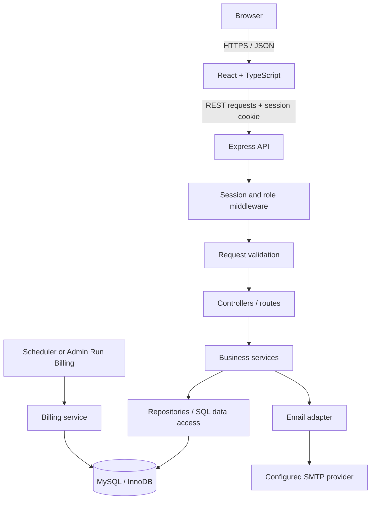

# System Architecture

> **Documentation update rule:** After every completed implementation step, update this file before beginning the next step. Change only information verified against the current code, database, tests, or running UI. Record the date, step completed, resulting behaviour, and any deviation or unresolved issue. Update `CHANGELOG.md` at the same time. Never mark an unimplemented or untested item as complete.

## 1. Architecture decision

Build a **modular monolith**: one React web client, one Express API, and one MySQL database. Organize the backend into feature modules but deploy it as one service. This keeps the system understandable and achievable for a solo hackathon build. Do not split it into microservices.

## 2. Technology components

| Component | Baseline | Responsibility |
|---|---|---|
| Web client | React + TypeScript + Vite | Admin, staff, and customer interfaces. |
| Styling | Tailwind CSS | Responsive layout and reusable visual patterns. |
| Routing | React Router | Role-aware page navigation. |
| API | Node.js + Express + TypeScript | HTTP interface, middleware, and service orchestration. |
| Validation | Zod | Runtime validation of request and configuration data. |
| Database | MySQL 8.4 / InnoDB | Persistent business data, foreign keys, transactions, and indexes. |
| Driver | `mysql2/promise` | Parameterized SQL and connection pool. |
| Authentication | `express-session` with persistent MySQL session store | Server-side sessions and secure cookies. |
| Passwords | Argon2id | Password hashing. |
| Scheduled billing | Optional in-process `setInterval` runner | Trigger the shared billing service when `BILLING_RUN_INTERVAL_MINUTES` is set; the manual Admin trigger is also available. |
| Email | SMTP adapter / Nodemailer | Password reset links and optional invoice sending. |

Confirm package compatibility and exact versions before installing; use lockfiles to make installs repeatable.

## 3. Component communication



The browser must never connect directly to MySQL. All reads and writes pass through the API so authorization, validation, and business rules are enforced in one place.

## 4. Backend request path

1. Express receives a request.
2. Security middleware applies headers, CORS policy, and rate limits where needed.
3. Session middleware identifies the signed-in user.
4. Role/ownership middleware checks access.
5. Zod validates body, parameters, and query strings.
6. Controller calls a service function.
7. Service applies business rules and starts a transaction when required.
8. Repository executes parameterized SQL.
9. Controller returns a predictable JSON response and HTTP status.
10. Central error middleware converts known errors into safe responses.

Keep business rules in services, not in React components or ad-hoc controller SQL. Repositories should focus on data access.

## 5. Suggested repository layout

```text
subscriptions/
├── client/
│   └── src/
│       ├── app/              # app router, providers
│       ├── components/       # reusable UI components
│       ├── features/         # auth, dashboard, products, plans, etc.
│       ├── layouts/          # admin/staff/customer shells
│       ├── lib/              # API client, formatters
│       └── types/            # shared frontend types
├── server/
│   ├── src/
│   │   ├── config/           # env and database pool
│   │   ├── middleware/       # session, roles, validation, errors
│   │   ├── modules/          # auth, users, products, plans, billing, etc.
│   │   ├── jobs/             # scheduled billing runner
│   │   ├── lib/              # money, dates, email, logger
│   │   ├── app.ts
│   │   └── server.ts
│   ├── migrations/
│   └── scripts/              # migration and seed commands
├── docs/                     # these Markdown documents
├── compose.yaml              # optional local MySQL container
├── .env.example
├── .gitignore
└── README.md
```

A feature module can follow this pattern:

```text
subscriptions/
  subscription.routes.ts
  subscription.controller.ts
  subscription.service.ts
  subscription.repository.ts
  subscription.schemas.ts
  subscription.types.ts
```

It is acceptable to combine a few files for a small MVP. Preserve the separation between HTTP handling, business rules, and SQL.

## 6. Database access

- Use a shared MySQL connection pool.
- Use prepared/parameterized statements for all user-supplied values.
- Never concatenate raw user input into SQL.
- Use allowlists for dynamic sort columns or SQL identifiers.
- Use transactions for subscription activation, invoice generation, discount redemption, payment recording, and any multi-table state transition.
- Use row locking (`SELECT ... FOR UPDATE`) where concurrent operations could violate a business invariant.
- Keep schema changes in ordered SQL migrations.

## 7. Frontend/backend boundary

Frontend responsibilities: routing, form state, display formatting, loading/error/empty states, and user interaction. Backend responsibilities: authentication, authorization, validation, price and tax calculation, subscription transitions, billing periods, invoice totals, discount eligibility, payment balances, and reporting data.

Do not trust totals, role names, customer IDs, or status changes supplied by the browser. The backend derives the signed-in user and recalculates all sensitive values.

## 8. Operational modes

- **Local development:** Vite client, Express API, local MySQL or Docker Compose.
- **Demo:** same application flow with seeded, clearly fictional records. A manual Admin billing trigger provides a reliable demo fallback.
- **Production-like deployment:** deploy frontend and API with HTTPS, managed MySQL, persistent session storage, SMTP configuration, and a scheduler that invokes the same billing service. Do not claim production readiness based solely on a successful local demo.

## 9. Architecture trade-offs

The modular monolith deliberately avoids message brokers, service discovery, multiple databases, and a separate worker deployment. Those may be future improvements, but they increase setup and operational burden without improving the core challenge workflow enough to justify the cost.
