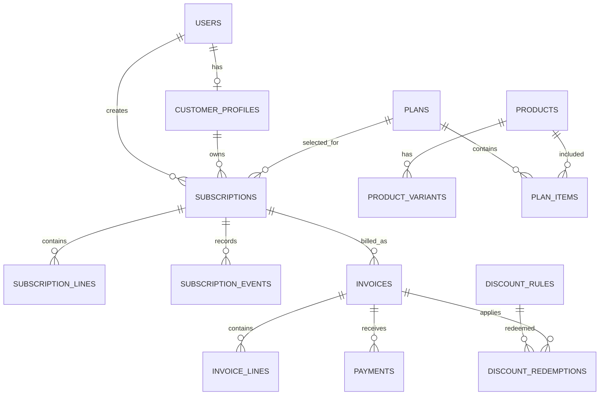

# Database Design and Data Model

> **Documentation update rule:** After every completed implementation step, update this file before beginning the next step. Change only information verified against the current code, database, tests, or running UI. Record the date, step completed, resulting behaviour, and any deviation or unresolved issue. Update `CHANGELOG.md` at the same time. Never mark an unimplemented or untested item as complete.

## 1. Design principles

- Use MySQL 8.4 with InnoDB.
- Use primary keys, foreign keys, unique constraints, and indexes to protect invariants.
- Use `DECIMAL(12,2)` or a documented integer-minor-unit representation for money; do not use JavaScript floating-point arithmetic for financial totals.
- Use UTC timestamps in storage where practical and convert for display. Document the business timezone used for billing dates.
- Store historical snapshots on subscriptions and invoices so catalogue edits do not rewrite past agreements.
- Keep migration files in version control. Never rely on manually created production tables.

## 2. Main entities

### Identity and access

**`users`**

- `id` primary key
- `email` normalized and unique
- `password_hash`
- `role` enum/value: `ADMIN`, `STAFF`, `CUSTOMER`
- `is_active`, `created_at`, `updated_at`

**`customer_profiles`**

- `id` primary key
- `user_id` unique foreign key to `users`
- `display_name`, `company_name`, contact fields, billing address fields

**`sessions`**

Persistent session store managed by the chosen session-store package. Do not store plaintext passwords or reset tokens here.

**`password_reset_tokens`**

- `id`, `user_id`, `token_hash`, `expires_at`, `used_at`, `created_at`
- Store only a hash of the one-time token.

### Catalogue and plans

**`products`**

- `id`, `name`, `type`, `sales_price`, `cost_price`, `notes`, `is_active`, timestamps

**`product_variants`**

- `id`, `product_id`, `name` or option label, `price_adjustment`, `is_active`
- Example: a variant called Odoo Brand may apply a +560 price adjustment, based on the brief's example.

**`taxes`**

- `id`, `name`, `rate`, `tax_mode` (exclusive/inclusive), `is_active`, timestamps

**`plans`**

- `id`, `name`, description, `price`, `billing_interval_unit` (`DAY`, `WEEK`, `MONTH`, `YEAR`), `billing_interval_count` (default 1), `minimum_quantity`, `available_from`, `available_until`
- plan controls: `allow_pause`, `allow_early_close`, `allow_renewal`, `auto_close`, `is_active`

**`plan_items`**

- `id`, `plan_id`, `product_id`, optional `variant_id`, `quantity`, agreed/default unit price, tax reference

### Quotations and subscriptions

**`quotation_templates`**

- `id`, `name`, `validity_days`, optional default plan, `created_by`, timestamps

**`quotation_template_items`**

- `id`, `template_id`, `product_id`, optional `variant_id`, `quantity`, unit price, tax reference

**`subscriptions`**

- `id`, unique `subscription_number`, `customer_id`, `plan_id`, optional `quotation_template_id`
- `status`, `start_date`, `expiry_date`, `payment_terms_days`
- `next_billing_at`, optional `last_billed_period_start`/`last_billed_period_end` if useful
- optional `previous_subscription_id` for renewal history
- `paused_at`, `closed_at`, `created_by`, timestamps

**`subscription_lines`**

- `id`, `subscription_id`, `product_id`, optional `variant_id`
- `description_snapshot`, `quantity`, `unit_price`, tax snapshot/reference, `line_amount`

**`subscription_events`**

- `id`, `subscription_id`, `actor_user_id`, `event_type`, `from_status`, `to_status`, `reason`, `created_at`

### Discounts

**`discount_rules`**

- `id`, `name`, `discount_type` (`FIXED`/`PERCENTAGE`), `value`
- `minimum_purchase`, `minimum_quantity`, `starts_at`, `ends_at`, `usage_limit`, `usage_count`
- `scope` (`PRODUCTS`/`SUBSCRIPTION`), `is_active`, `created_by`, timestamps

**`discount_products`**

- Join table connecting discount rules to allowed products.

**`discount_redemptions`**

- `id`, `discount_rule_id`, `subscription_id`, `invoice_id`, `customer_id`, `redeemed_at`
- Add a suitable unique constraint if the selected policy prevents repeated use by the same customer/subscription.

### Invoices and payments

**`invoices`**

- `id`, unique `invoice_number`, `subscription_id`, `customer_id`
- `period_start`, `period_end`, `issue_date`, `due_date`, `currency_code`
- `subtotal`, `discount_total`, `tax_total`, `grand_total`
- `status` (`DRAFT`, `CONFIRMED`, `PAID`, `CANCELLED`)
- timestamps, optional `confirmed_at`, `cancelled_at`
- Add a unique constraint covering `(subscription_id, period_start, period_end)` to prevent duplicate period invoices.

**`invoice_lines`**

- `id`, `invoice_id`, optional source product/variant IDs
- `description_snapshot`, `quantity`, `unit_price`, `line_subtotal`
- `discount_amount`, `tax_name_snapshot`, `tax_rate_snapshot`, `tax_amount`, `line_total`

**`payments`**

- `id`, `invoice_id`, `method`, `amount`, `paid_at`, `note`, `reference`, `status`, `recorded_by`, `created_at`

### Audit and reporting

**`audit_logs`**

- `id`, `actor_user_id`, `action`, `entity_type`, `entity_id`, `metadata_json`, `created_at`
- Use for important admin/configuration changes and privileged state transitions. Avoid storing secrets or full sensitive payloads.

Reporting can initially use indexed queries over invoices, payments, and subscriptions. A separate reporting warehouse is not required.

## 3. Relationships

The exact foreign key layout may differ depending on whether `customer_id` points to `users` or `customer_profiles`. Pick one convention, document it, and use it consistently in migrations and API types.

## 4. Important constraints and indexes

At minimum, plan for:

- Unique index on normalized `users.email`.
- Unique index on `subscriptions.subscription_number`.
- Unique index on `invoices.invoice_number`.
- Unique invoice-period key on `(subscription_id, period_start, period_end)`.
- Index on `(status, next_billing_at)` for due subscriptions.
- Indexes on `subscriptions.customer_id`, `subscriptions.plan_id`, and relevant date fields.
- Indexes on `invoices.customer_id`, `(status, due_date)`, and `invoices.subscription_id`.
- Index on `payments.invoice_id` and `payments.paid_at`.
- Foreign keys for all ownership relationships.

Add indexes based on the actual filter/order patterns used by the UI. Avoid indexing every column without evidence.

## 5. Historical snapshots

Copy agreed names, descriptions, unit prices, variant adjustments, tax names/rates/modes, currency, and billing periods into the relevant subscription/invoice records. A historical invoice must not change when an Admin edits the catalogue later. Keep source foreign keys as references, but use snapshots for historical calculations and rendering.

## 6. Money and time

- Never use binary floating-point for money calculations. Use integer minor units or MySQL `DECIMAL` values and a safe decimal library/strategy in Node.
- Keep rounding rules in one shared money module. Round only at documented calculation boundaries.
- Store timestamps consistently (recommended UTC) and display in the selected business/user timezone.
- Define whether billing uses calendar dates or exact timestamps. For plan billing, use a consistent local billing timezone and test daylight-saving transitions if applicable.
- For monthly/yearly recurrence, avoid JavaScript date overflow; implement explicit calendar-month/year addition with end-of-month clamping.

## 7. Migration policy

- Number migrations in order, e.g. `001_create_users.sql`.
- A migration runner records applied filenames in `schema_migrations`.
- Never silently edit a migration that has already been applied in a shared environment; add a new migration.
- Seed data should be deterministic and obviously fake.
- Document how to reset a local database without deleting production data.
