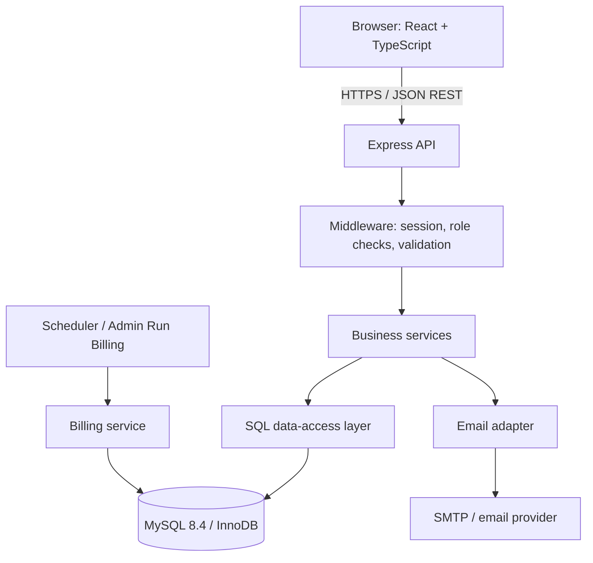
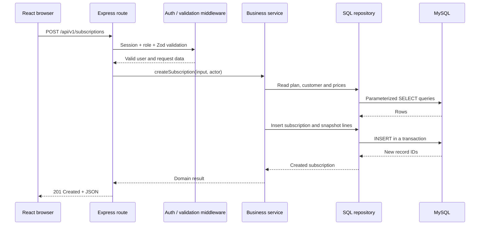
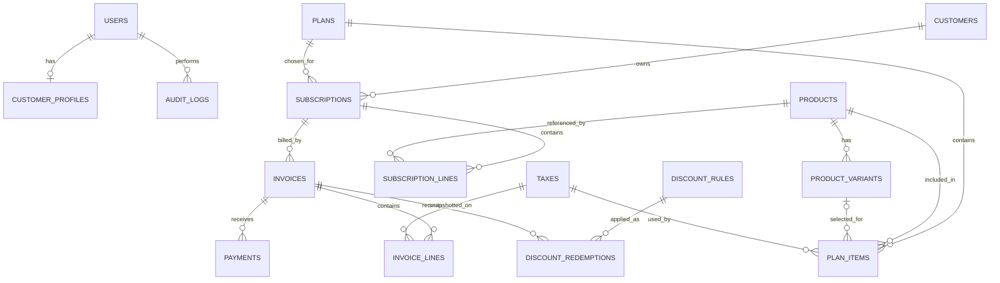

# Documentation maintenance rule

> **Update this file after every completed implementation step.** Before starting the next step, revise any affected details in this document so it describes the code that actually exists. Record the date, implementation step, verified result, and any deviation from this blueprint. Do not mark a feature complete unless it has been tested. Update `CHANGELOG.md` in the same work session/commit.

> This is the previously created technical development blueprint. Its original content is preserved below this maintenance note. Treat it as a detailed companion to the shorter, topic-specific documents in this pack. Where it conflicts with a later, explicitly recorded project decision, update both documents and record the decision in `CHANGELOG.md`.

---

# Make-A-Ton 9.0 — Subscription Management System
## Complete technical architecture, stack selection, database design, API plan and implementation guide

> **Purpose:** This document is the technical starting blueprint for building the Brightloop Software Subscription Management System problem statement as a solo participant. It explains what to build, why each technology is selected, how the frontend/backend/database connect, how the core business logic should work, and how to implement and test the system within a limited hackathon window.
>
> **Source of truth:** Functional requirements in this guide are taken from the supplied `Subscription_Management_System.pdf`. Design choices that the problem statement does not specify—such as exact tax rounding, discount stacking, authentication implementation and monthly end-of-month behaviour—are explicitly presented as recommended implementation decisions, not as organizer-mandated rules.

---

## Contents

1. [Executive recommendation](#1-executive-recommendation)
2. [Understand the problem before coding](#2-understand-the-problem-before-coding)
3. [Recommended technology stack](#3-recommended-technology-stack)
4. [System architecture](#4-system-architecture)
5. [How the components connect](#5-how-the-components-connect)
6. [Database design](#6-database-design)
7. [Business logic and calculations](#7-business-logic-and-calculations)
8. [Recurring billing engine](#8-recurring-billing-engine)
9. [REST API design](#9-rest-api-design)
10. [Authentication, authorization and security](#10-authentication-authorization-and-security)
11. [Frontend application design](#11-frontend-application-design)
12. [Backend project structure](#12-backend-project-structure)
13. [Development setup](#13-development-setup)
14. [Environment variables and configuration](#14-environment-variables-and-configuration)
15. [Implementation sequence for the online round](#15-implementation-sequence-for-the-online-round)
16. [Testing and quality checklist](#16-testing-and-quality-checklist)
17. [Performance plan for thousands of subscriptions](#17-performance-plan-for-thousands-of-subscriptions)
18. [Deployment and demo strategy](#18-deployment-and-demo-strategy)
19. [Features to avoid during the eight-hour round](#19-features-to-avoid-during-the-eight-hour-round)
20. [Common implementation mistakes](#20-common-implementation-mistakes)
21. [Final build checklist](#21-final-build-checklist)
22. [Technical references](#22-technical-references)

---

# 1. Executive recommendation

## 1.1 Build this architecture

Use a **modular monolithic web application**:

- **Frontend:** React + TypeScript + Vite.
- **UI styling:** Tailwind CSS, with a small reusable component system.
- **Backend:** Node.js 24 LTS + Express 5 + TypeScript.
- **Database:** MySQL 8.4, using the InnoDB storage engine.
- **Database access:** `mysql2/promise` with parameterized SQL queries and a shared connection pool.
- **Validation:** Zod on the API boundary; repeat critical constraints in the database.
- **Authentication:** server-side sessions stored in MySQL, with secure HTTP-only cookies.
- **Password hashing:** Argon2id.
- **Frontend data fetching:** TanStack Query or a small typed `fetch` wrapper. Do not introduce both a complex state library and a query library unless needed.
- **Charts:** Recharts, only for dashboard visualizations.
- **Recurring jobs:** a small Node scheduler (`node-cron`) calling the same billing service used by the manual admin action.
- **Git:** one repository with separate `client` and `server` directories.

### Why this is the recommended stack

The problem is a conventional business application with strongly related entities: customers, products, variants, plans, subscriptions, invoices, payments, taxes and discounts. A relational database is a natural fit. MySQL provides foreign keys, transactions, indexes and exact decimal numeric types. Express provides a small API layer that is easy to understand and debug. React and TypeScript are suitable for the multiple dashboards and forms.

This stack is also a practical choice for a solo build: it avoids microservices, message brokers, multiple databases and unnecessary infrastructure. It uses technologies that are already common in a React/Node/MySQL workflow.

## 1.2 Architecture at a glance



The browser must **never connect directly to MySQL**. It sends HTTP requests to the backend. The backend validates the request, checks the user's permissions, performs business logic and reads/writes the database.

## 1.3 Keep the architecture simple

Do not build microservices for this challenge. A modular monolith means:

- One frontend application.
- One backend application.
- One relational database.
- Separate backend modules for authentication, products, plans, subscriptions, billing, payments and reports.
- One deployable API process for the MVP.

The modules are separated in code, but they share one database and can call each other's service functions. This is easier to build and test in eight hours than a distributed architecture.

## 1.4 What counts as a successful MVP

A judge should be able to follow this complete journey without the developer manually editing database rows:

1. Admin creates a product and a plan.
2. A customer account exists and the customer can sign in.
3. A staff member or customer creates a subscription from the plan.
4. The subscription is confirmed and activated.
5. The billing service generates an invoice for a due subscription.
6. The invoice contains the correct product lines, tax and applicable discount.
7. Staff records a payment against the invoice.
8. The invoice becomes paid or partially paid.
9. The dashboard reflects the updated paid amount, outstanding balance and active subscription count.

This single connected workflow is more convincing than many disconnected CRUD screens.

---

# 2. Understand the problem before coding

## 2.1 The business being modelled

The fictional company, **Brightloop Software**, sells products through recurring subscriptions. It has:

- Products and product variants.
- Plans billed daily, weekly, monthly or yearly.
- Customers ranging from small businesses to larger organizations.
- Admin users who configure the system.
- Staff who handle day-to-day work.
- Customers who use a self-service portal.
- Recurring invoices, taxes, discounts and payments.
- Management reports for revenue and outstanding amounts.

The current manual workflow uses spreadsheets, remembered renewal dates, manually prepared invoices and manual payment matching. Your application replaces those disconnected activities with one source of truth.

## 2.2 Requirements extracted from the supplied problem statement

| Area | Required behaviour |
|---|---|
| Customer registration | Email and password registration; each email belongs to one account. |
| Password policy | More than eight characters, with uppercase, lowercase and special characters. |
| Password reset | A reset link must be sent to the registered email. |
| Roles | Admin, staff and customer have different permissions. |
| Staff management | Only the admin can add staff members. |
| Products | Store name, type, sales price, cost price and notes. |
| Variants | A variant can add an additional amount to the product price; the example mentions the Odoo brand adding 560. |
| Plans | Billing frequency can be daily, weekly, monthly or yearly; store minimum quantity and availability dates. |
| Plan rules | Admin decides whether subscriptions can auto-close, close early, pause or renew. |
| Quotation templates | Pre-filled plan/product lines and a validity duration. |
| Subscriptions | Unique number, customer, plan, dates, payment terms and product lines. |
| Subscription states | Draft, Quotation, Confirmed, Active and Closed; pause and renewal behaviour is also required. |
| Billing | Generate invoices from subscriptions automatically; avoid skipped or duplicated billing. |
| Invoice contents | Customer details, product lines, taxes and totals. |
| Invoice actions | Confirm, cancel, send and print. |
| Invoice states | Draft, Confirmed and Paid are the stated core statuses. |
| Taxes | Admin-configured rules calculate tax automatically. |
| Discounts | Admin-only fixed or percentage rules, with minimum purchase/quantity, date range and usage limit. |
| Discount scope | A discount can apply to selected products or to a whole subscription. |
| Payments | Record method, amount, date and note against the correct invoice. |
| Finance dashboard | Show active subscriptions, revenue received, outstanding amounts and overdue invoices, with filters and summary views. |
| Performance | Pages should respond in under two seconds with thousands of subscriptions. |

## 2.3 Translate requirements into application modules

| Module | Main responsibility | Main tables |
|---|---|---|
| Identity and access | Registration, login, reset, roles, staff creation | `users`, `customer_profiles`, `sessions`, `password_reset_tokens` |
| Product catalogue | Products and price-changing variants | `products`, `product_variants` |
| Plan configuration | Billing cycle, plan dates, plan lines and controls | `plans`, `plan_items`, `taxes` |
| Quotation | Reusable quotation templates and validity | `quotation_templates`, `quotation_template_items` |
| Subscription | Customer's contracted recurring service | `subscriptions`, `subscription_lines`, `subscription_events` |
| Discounts | Rules, scope and applications | `discount_rules`, `discount_products`, `discount_redemptions` |
| Invoicing | Immutable billing document for a billing period | `invoices`, `invoice_lines` |
| Payments | Money received against an invoice | `payments` |
| Reporting | Aggregated business metrics | Queries over subscriptions, invoices and payments |
| Audit | Important state and configuration changes | `audit_logs` |

## 2.4 Scope decisions that the problem statement does not define

Do not silently invent behaviour and then treat it as an official rule. Choose clear defaults, document them in the README and keep the business logic in service functions so the rules can be changed.

Recommended MVP decisions:

1. **Currency:** use INR for the demo, but store the currency code on invoices so the design can support other currencies later.
2. **Tax:** use exclusive tax by default. Store the tax rate and tax mode on invoice lines as a historical snapshot.
3. **Discount stacking:** do not stack multiple discounts in the MVP. Apply the highest-value eligible rule, or select the rule with the highest admin-defined priority. Document which policy you implement.
4. **Partial payments:** support them. The prompt says payments can arrive on different days; multiple payment rows per invoice allow that naturally.
5. **Overdue:** calculate it from `due_date < today` and a positive outstanding balance. It does not need to be a separately stored invoice state.
6. **Renewal:** create a new subscription linked to the previous subscription, rather than overwriting the old contract. This preserves history.
7. **Pause:** a paused subscription is not billed. On resume, define whether the next billing date is shifted or whether the customer catches up. For the MVP, shift the next billing date so a paused period is not billed.
8. **Monthly date behaviour:** preserve the original day-of-month where possible; if the target month is shorter, use its last day. Avoid accidental date drift.
9. **Payment processing:** the problem asks to record payments. It does not require a live card gateway. Record UPI, bank transfer, cash, card or other payment methods manually; do not collect or store card numbers.
10. **Email:** use an SMTP/email provider for real reset links. In local development, a logged reset URL is acceptable only as a development fallback, not as the completed production behaviour.

---

# 3. Recommended technology stack

## 3.1 Frontend

### React + TypeScript

**Purpose:** Build the customer portal, staff workspace and admin interface.

**Why React:**

- The interface is made of reusable pieces: tables, filters, forms, status badges, invoice summaries and dashboards.
- Different users see different navigation and pages, but many components can be reused.
- React's component model makes it practical to keep forms, tables and status views separate.

**Why TypeScript:**

- API responses and request payloads have known shapes.
- It catches many mistakes while writing code, such as using a string where an invoice amount or status is expected.
- It helps keep shared frontend types consistent as the project grows.

**Build tool: Vite.** It gives a fast development server and production build. Create a React TypeScript project using the Vite template.

### Frontend supporting libraries

| Library | Use | Why / priority |
|---|---|---|
| React Router | Page navigation | Needed for admin, staff and customer routes. |
| Tailwind CSS | Styling | Fast responsive styling and consistent spacing. |
| TanStack Query | API data fetching/cache | Handles loading, errors, caching and refetching after mutations. Recommended, but a small fetch wrapper is sufficient for a tiny app. |
| React Hook Form | Forms | Reduces form state boilerplate. Optional. |
| Zod | Frontend validation | Keeps form constraints consistent with the backend. The backend remains authoritative. |
| Recharts | Dashboard charts | Useful for revenue trends, but not more important than correct totals. |
| Lucide React | Icons | Consistent icon set. Optional. |

Do not install every library automatically. Start with React Router, Tailwind and a typed API helper. Add TanStack Query and React Hook Form only if they make the implementation faster.

### Why not build the entire interface in plain HTML?

The system has multiple roles, reusable data tables, forms and dashboards. A component framework makes repeated UI and state updates much easier. The backend and business logic are still more important than choosing a fashionable frontend library.

## 3.2 Backend

### Node.js 24 LTS + Express 5 + TypeScript

**Node.js** runs the API server and the recurring billing worker.

**Express** handles HTTP routes and middleware. It is small, familiar and does not force a database, ORM or application architecture.

**TypeScript** gives the backend type checking for request DTOs, domain models and service functions. Runtime validation is still required: TypeScript types disappear at runtime and cannot validate untrusted HTTP input.

**Why Express rather than NestJS or a larger framework?**

- Less framework setup in an eight-hour build.
- Simple request/response model.
- Easy to split routes, middleware, services and repositories into folders.
- The challenge does not need a complex dependency-injection framework.

Node 24 is a mature LTS baseline. Node 26 has also entered LTS in the October 2026 release schedule, but Node 24 is a conservative choice when compatibility with packages and local tooling is more important than using the newest major release. Check the official Node release schedule before installing a different version.

### Backend supporting libraries

| Package | Purpose |
|---|---|
| `express` | HTTP server and routing |
| `cors` | Allow the frontend origin to call the API during local development |
| `helmet` | Security-related HTTP response headers |
| `express-rate-limit` | Basic rate limiting, especially for login and password reset |
| `mysql2` | MySQL driver with promise API and prepared statements |
| `zod` | Runtime validation of request bodies, query parameters and environment variables |
| `argon2` | Password hashing using Argon2id |
| `express-session` | Server-side login sessions |
| `express-mysql-session` | Store sessions in MySQL instead of process memory |
| `node-cron` | Run the recurring billing service on a schedule |
| `nodemailer` | Send password reset links and optional invoice emails via SMTP |
| `pino` or `pino-http` | Structured application logs; optional for the MVP |
| `tsx` | Run TypeScript during local development |

Keep the dependency list small. Do not add Redis, Kafka, GraphQL or microservice frameworks for this challenge.

## 3.3 Database: MySQL 8.4 with InnoDB

**Recommendation: MySQL 8.4, InnoDB, `utf8mb4` character set.**

Why a relational database?

- A subscription belongs to a customer and a plan.
- A product can have variants.
- A plan contains product lines.
- A subscription contains snapshot lines.
- An invoice belongs to a subscription and has invoice lines.
- A payment belongs to an invoice.
- Discounts can be linked to products and invoices.

These relationships are naturally represented with primary keys, foreign keys and join tables.

Why MySQL?

- It is familiar within a Node.js development workflow.
- InnoDB supports transactions, row-level locking, foreign keys and multi-version concurrency control.
- `DECIMAL` is suitable for monetary values because it stores exact fixed-precision numbers rather than binary floating-point approximations.
- It can run locally or on a managed database service.

### Why not MongoDB for this system?

MongoDB is useful for flexible document-shaped data, but this problem has many connected entities and financial records. A relational schema makes it easier to enforce relationships, uniqueness and transactional updates. It is possible to build the system with MongoDB, but it is not the simplest fit for this particular domain.

### Why not SQLite?

SQLite is useful for lightweight local applications and prototypes. However, MySQL better matches the relational server-side workload and gives a more direct path to concurrent billing operations and the expected multi-user application.

### Why not use both MySQL and MongoDB?

There is no requirement that needs a second database. Two databases would add connection configuration, data consistency problems and more debugging without improving this MVP.

## 3.4 Database access: `mysql2/promise` instead of an ORM

Use `mysql2/promise` with parameterized SQL queries.

**Why direct SQL for this hackathon?**

- The schema and queries remain visible and explicit.
- You can write exact joins and aggregate queries for reporting.
- You do not need to learn ORM conventions or debug generated queries under time pressure.
- Transactions and locking behaviour are visible in the code.
- It keeps the stack aligned with the MySQL database the application actually uses.

Trade-off: you write more SQL and must maintain TypeScript types for query results. Keep SQL in repository files and validate data before calling those repositories.

**Do not concatenate user input into SQL strings.** Use placeholders such as `WHERE id = ?` and pass values separately. For dynamic sorting, map requested sort keys to an allowlist of literal SQL column names; identifiers cannot be safely supplied as ordinary value parameters.

An ORM such as Drizzle or Prisma can be useful if you already know it. Do not introduce an unfamiliar ORM on hackathon day. Confirm its current database support and major-version setup before starting; ORM support and setup instructions can change between releases.

## 3.5 API style: REST + JSON

Use REST endpoints such as:

- `GET /api/v1/products`
- `POST /api/v1/products`
- `GET /api/v1/subscriptions/:id`
- `POST /api/v1/subscriptions/:id/activate`
- `POST /api/v1/invoices/:id/payments`

Why REST?

- The application's resources map naturally to URLs.
- It is straightforward to inspect with browser dev tools, Postman or `curl`.
- It is easy to implement with Express.
- It makes the frontend/backend boundary clear.

Send and receive JSON for ordinary API data. Use a separate PDF response or file download route for printing invoices.

## 3.6 Payment integration: do not add a real gateway unless needed

The problem statement asks for payments to be recorded with method, amount, date and a note against the correct invoice. It does **not** require the application to debit a real bank account or accept live card payments.

For the MVP:

- Provide payment methods such as UPI, bank transfer, cash, card and other.
- A staff user records an amount and payment date.
- The backend validates the amount and invoice balance.
- The backend inserts the payment and recalculates invoice status in one transaction.

A real gateway such as Razorpay or Stripe would add merchant onboarding, webhooks, signature verification, test credentials and external failure cases. Treat it as a future extension, not a core requirement.

---

# 4. System architecture

## 4.1 Layer responsibilities

Keep four backend layers distinct:

| Layer | Responsibility | Example |
|---|---|---|
| Route/controller | HTTP input/output; call services; choose status code | `POST /subscriptions` |
| Middleware | Session, permissions, request validation, logging | `requireRole('ADMIN')` |
| Service/domain | Business rules and transactional workflows | `createSubscription()`, `generateInvoice()` |
| Repository/data access | SQL queries only | `subscriptionRepository.findDue()` |

### Request flow



## 4.2 Why the service layer matters

Do not calculate invoice totals inside a React component or directly inside an Express route. Put the logic in reusable backend functions.

For example:

- `calculateInvoiceTotals()` calculates base amount, discount, tax and grand total.
- `canTransitionSubscription()` checks a state transition.
- `evaluateDiscounts()` returns eligible discount rules.
- `generateInvoiceForSubscription()` creates a due invoice safely.
- `recordPayment()` records a payment and updates invoice balance.

The same service can be called from an HTTP route, a scheduled worker or a test. This avoids duplicating business rules.

## 4.3 Separate command/query responsibilities without overengineering

It is useful to distinguish:

- **Commands:** create a product, activate a subscription, generate an invoice, record a payment.
- **Queries:** list subscriptions, find overdue invoices, retrieve dashboard totals.

You do not need a formal CQRS framework. Just keep write services separate from reporting/list query functions.

---

# 5. How the components connect

## 5.1 Local development connection map

```text
Browser
  React app: http://localhost:5173
       |
       | HTTP JSON requests (fetch)
       | credentials: "include" for cookie sessions
       v
Express API: http://localhost:4000
       |
       | mysql2 pool / prepared statements
       v
MySQL: localhost:3306

Optional:
Express API ---> SMTP server/email provider
Node scheduler ---> same billing service ---> MySQL
```

Ports are examples. They can be changed in environment variables.

## 5.2 Frontend-to-backend connection

The frontend does not query SQL. It calls a backend endpoint.

Example:

1. The admin opens the Products page.
2. React calls `GET /api/v1/products?page=1&limit=20`.
3. Express checks the session and role.
4. The product service calls the product repository.
5. The repository runs a parameterized SQL query.
6. MySQL returns rows.
7. Express serializes a JSON response.
8. React renders the table.

When a product is created, the direction is similar but uses `POST` and an insert query.

## 5.3 Backend-to-database connection

Create one connection pool when the server starts. Do not create a new connection for each request.

A pool:

- Reuses database connections.
- Limits concurrent open connections.
- Queues requests when the pool is busy.
- Gives one central place for connection configuration.

Use transactions for operations that must succeed or fail together. Examples include:

- Creating a user and their customer profile.
- Creating a subscription and its lines.
- Generating an invoice and advancing the subscription's next billing date.
- Recording a payment and updating invoice status.
- Applying a limited-use discount and recording its redemption.

## 5.4 CORS and cookies in local development

The Vite frontend and Express backend commonly use different ports, so they have different origins.

Configure the API to:

- Allow only the exact frontend origin, such as `http://localhost:5173`.
- Set `credentials: true` in CORS.
- Use `credentials: 'include'` in frontend `fetch` calls.
- Never use `Access-Control-Allow-Origin: *` when cookies/credentials are enabled.

In production, serving the frontend and API under the same site (for example, frontend at the domain root and API under `/api`) makes cookie configuration and CORS simpler.

## 5.5 Frontend must not contain secrets

Vite variables beginning with `VITE_` are exposed to browser code. It is acceptable to put a public API base URL in `VITE_API_BASE_URL`. It is not acceptable to put database passwords, SMTP passwords, session secrets or API private keys in `VITE_` variables.

---

# 6. Database design

## 6.1 Database principles

1. Every table has a primary key.
2. Related rows use foreign keys.
3. Email addresses are normalized to lowercase and unique.
4. Prices, taxes and discounts use `DECIMAL`, never `FLOAT` or `DOUBLE`.
5. Invoice and invoice-line records preserve a historical snapshot of what was charged.
6. A subscription/invoice relationship must prevent a duplicate invoice for the same billing period.
7. Important state changes should be auditable.
8. Financial records should not be physically deleted once confirmed. Cancel or void them and preserve history.
9. Use `ON DELETE RESTRICT` for important financial relationships unless there is a deliberate reason to cascade.
10. Use UTC for timestamps, and consistently apply the business timezone for date-based billing. For this event, the UI can display Asia/Kolkata time.

## 6.2 Entity relationship overview



The diagram is conceptual. Implement the exact foreign keys and optional relationships described below.

## 6.3 Identity tables

### `users`

Stores authentication identity and role.

| Column | Suggested type | Notes |
|---|---|---|
| `id` | BIGINT UNSIGNED PK | Auto-increment ID |
| `email` | VARCHAR(254) UNIQUE | Store normalized lowercase email |
| `password_hash` | VARCHAR(255) | Argon2id hash only; never plaintext |
| `full_name` | VARCHAR(150) | Display name |
| `role` | ENUM | `ADMIN`, `STAFF`, `CUSTOMER` |
| `is_active` | BOOLEAN | Disable access without deleting history |
| `created_at` | DATETIME | UTC timestamp |
| `updated_at` | DATETIME | UTC timestamp |

The public registration route must always create a `CUSTOMER`. Do not accept a role from the request body. Create the initial admin using a seed script or a one-time secure setup command. Only an admin can create staff users.

### `customer_profiles`

One-to-one profile for users whose role is `CUSTOMER`.

| Column | Suggested type | Notes |
|---|---|---|
| `id` | BIGINT UNSIGNED PK | |
| `user_id` | BIGINT UNSIGNED UNIQUE FK | References `users.id` |
| `company_name` | VARCHAR(180) | Optional for an individual customer |
| `phone` | VARCHAR(30) | Optional |
| `billing_address` | TEXT | Optional |
| `tax_identifier` | VARCHAR(80) | Optional; do not assume every customer has one |
| `created_at` | DATETIME | |

The customer record should not duplicate email unless a separate billing contact email is intentionally supported. Use the user email by default.

### `password_reset_tokens`

| Column | Type | Notes |
|---|---|---|
| `id` | BIGINT UNSIGNED PK | |
| `user_id` | BIGINT UNSIGNED FK | User requesting reset |
| `token_hash` | CHAR(64) | Store a hash of the random token, not the raw token |
| `expires_at` | DATETIME | Short expiry, e.g. 30 minutes |
| `used_at` | DATETIME NULL | One-time use |
| `created_at` | DATETIME | |

Delete expired reset tokens periodically. Return a generic response from the forgot-password endpoint so an attacker cannot easily enumerate registered email addresses.

## 6.4 Product and variant tables

### `products`

| Column | Type | Notes |
|---|---|---|
| `id` | BIGINT UNSIGNED PK | |
| `name` | VARCHAR(180) | Required |
| `product_type` | VARCHAR/ENUM | Define supported types in the UI |
| `sales_price` | DECIMAL(12,2) | Selling price before applicable tax |
| `cost_price` | DECIMAL(12,2) | Internal cost; customer APIs must not expose it |
| `notes` | TEXT NULL | |
| `is_active` | BOOLEAN | Soft-disable catalogue item |
| `created_at` | DATETIME | |
| `updated_at` | DATETIME | |

### `product_variants`

| Column | Type | Notes |
|---|---|---|
| `id` | BIGINT UNSIGNED PK | |
| `product_id` | BIGINT UNSIGNED FK | References `products.id` |
| `attribute_name` | VARCHAR(80) | Example: Brand |
| `attribute_value` | VARCHAR(120) | Example: Odoo |
| `price_delta` | DECIMAL(12,2) | Additional amount; can be zero or negative if business policy allows |
| `sku` | VARCHAR(80) NULL | Optional unique SKU |
| `is_active` | BOOLEAN | |

Example: a product has a base sales price of ₹2,000 and the Odoo variant has a price delta of ₹560. The variant-adjusted price is ₹2,560 before tax. Do not hardcode the 560 amount in the frontend; store it as data.

## 6.5 Tax table

### `taxes`

| Column | Type | Notes |
|---|---|---|
| `id` | BIGINT UNSIGNED PK | |
| `name` | VARCHAR(100) | Example: GST 18% |
| `rate` | DECIMAL(7,4) | Example: `18.0000` |
| `calculation_type` | ENUM | `EXCLUSIVE` or `INCLUSIVE` |
| `is_active` | BOOLEAN | |
| `created_at` | DATETIME | |

A tax is a configurable rule. The problem statement does not prescribe a specific tax jurisdiction or tax rate. Use clearly labelled demo taxes and do not imply that a demo tax configuration is legal tax advice.

## 6.6 Plan tables

### `plans`

| Column | Type | Notes |
|---|---|---|
| `id` | BIGINT UNSIGNED PK | |
| `name` | VARCHAR(180) | Required |
| `description` | TEXT NULL | |
| `billing_interval` | ENUM | `DAILY`, `WEEKLY`, `MONTHLY`, `YEARLY` |
| `interval_count` | INT | Usually 1; supports every 2 months, etc. if desired |
| `minimum_quantity` | INT | Must be at least 1 |
| `available_from` | DATE | Plan sales start date |
| `available_until` | DATE NULL | Plan sales end date |
| `auto_close_on_end` | BOOLEAN | Close subscription at expiry if enabled |
| `allow_early_close` | BOOLEAN | Admin-controlled policy |
| `allow_pause` | BOOLEAN | Admin-controlled policy |
| `allow_renew` | BOOLEAN | Admin-controlled policy |
| `is_active` | BOOLEAN | Catalogue availability |
| `created_at` | DATETIME | |
| `updated_at` | DATETIME | |

**Important distinction:** plan availability dates determine when a plan can be sold. A subscription's start and expiry dates determine the contract period for one customer. These are not the same dates.

### `plan_items`

A plan can contain one or more product lines.

| Column | Type | Notes |
|---|---|---|
| `id` | BIGINT UNSIGNED PK | |
| `plan_id` | BIGINT UNSIGNED FK | |
| `product_id` | BIGINT UNSIGNED FK | |
| `variant_id` | BIGINT UNSIGNED NULL FK | Optional chosen variant |
| `default_quantity` | DECIMAL(10,2) | Positive quantity |
| `unit_price_override` | DECIMAL(12,2) NULL | Null means calculate from product + variant |
| `tax_id` | BIGINT UNSIGNED NULL FK | Tax rule to apply |
| `created_at` | DATETIME | |

A subscription should copy the relevant plan lines into its own `subscription_lines` table. Do not make historical invoices depend on a product's current price.

## 6.7 Quotation template tables

### `quotation_templates`

| Column | Type | Notes |
|---|---|---|
| `id` | BIGINT UNSIGNED PK | |
| `name` | VARCHAR(180) | |
| `description` | TEXT NULL | |
| `plan_id` | BIGINT UNSIGNED NULL FK | Optional default plan |
| `validity_days` | INT | Number of days quote remains valid |
| `is_active` | BOOLEAN | |
| `created_by` | BIGINT UNSIGNED FK | Staff/admin user |

### `quotation_template_items`

Store pre-filled product/variant/quantity/price/tax rows. When a quotation is created from a template, copy its lines into the quotation/subscription. Do not display live template values as though they were immutable quotation values.

For a compact MVP, you can keep quotation data directly on the `subscriptions` record (`status = QUOTATION`, `quotation_valid_until`) and copy template lines into `subscription_lines`. A separate quotation table is optional unless multiple revisions or quote history are required.

## 6.8 Subscription tables

### `subscriptions`

| Column | Type | Notes |
|---|---|---|
| `id` | BIGINT UNSIGNED PK | Internal identifier |
| `subscription_number` | VARCHAR(40) UNIQUE | Human-readable unique number |
| `customer_id` | BIGINT UNSIGNED FK | References `customer_profiles.id` |
| `plan_id` | BIGINT UNSIGNED FK | Chosen plan |
| `status` | ENUM | `DRAFT`, `QUOTATION`, `CONFIRMED`, `ACTIVE`, `PAUSED`, `CLOSED` |
| `start_date` | DATE | Contract start |
| `expiry_date` | DATE NULL | Contract end; nullable for open-ended subscriptions if allowed |
| `quotation_valid_until` | DATE NULL | Only relevant in quotation stage |
| `payment_terms_days` | INT | Example: 15 means due 15 days after invoice issue |
| `next_billing_date` | DATE NULL | Indexed; billing engine uses it |
| `renewed_from_id` | BIGINT UNSIGNED NULL FK | Previous subscription if this is a renewal |
| `paused_at` | DATETIME NULL | |
| `closed_at` | DATETIME NULL | |
| `close_reason` | VARCHAR(255) NULL | |
| `created_by` | BIGINT UNSIGNED FK | Audit attribution |
| `created_at` | DATETIME | |
| `updated_at` | DATETIME | |

### `subscription_lines`

| Column | Type | Notes |
|---|---|---|
| `id` | BIGINT UNSIGNED PK | |
| `subscription_id` | BIGINT UNSIGNED FK | |
| `product_id` | BIGINT UNSIGNED NULL FK | Preserve even if product is later archived |
| `variant_id` | BIGINT UNSIGNED NULL FK | Optional |
| `description_snapshot` | VARCHAR(255) | Product name/variant description at sale time |
| `quantity` | DECIMAL(10,2) | Positive |
| `unit_price` | DECIMAL(12,2) | Agreed unit price snapshot |
| `tax_id` | BIGINT UNSIGNED NULL FK | Reference for reporting, if still present |
| `tax_rate_snapshot` | DECIMAL(7,4) | Rate used for the contract |
| `tax_type_snapshot` | ENUM | `EXCLUSIVE` / `INCLUSIVE` |
| `created_at` | DATETIME | |

Do not recalculate a signed/confirmed subscription price from a current product catalogue value. If a price changes, an existing customer should keep the agreed amount unless an explicit contract change is performed.

### `subscription_events`

Record important transitions such as `QUOTATION_CREATED`, `CONFIRMED`, `ACTIVATED`, `PAUSED`, `RESUMED`, `RENEWED` and `CLOSED`, along with actor, timestamp and optional note. This creates a readable history without overwriting the previous state.

## 6.9 Discount tables

### `discount_rules`

| Column | Type | Notes |
|---|---|---|
| `id` | BIGINT UNSIGNED PK | |
| `name` | VARCHAR(150) | |
| `discount_type` | ENUM | `FIXED` or `PERCENTAGE` |
| `value` | DECIMAL(12,2) | Currency amount or percentage value |
| `scope` | ENUM | `PRODUCTS` or `SUBSCRIPTION` |
| `minimum_purchase` | DECIMAL(12,2) NULL | Minimum eligible amount |
| `minimum_quantity` | DECIMAL(10,2) NULL | Minimum combined eligible quantity |
| `starts_at` | DATETIME | Valid from |
| `ends_at` | DATETIME | Valid through |
| `max_uses` | INT NULL | Null can mean unlimited |
| `used_count` | INT | Maintain transactionally; can also derive from redemptions |
| `priority` | INT | Optional deterministic selection order |
| `is_active` | BOOLEAN | |
| `created_by` | BIGINT UNSIGNED FK | Admin only |

### `discount_products`

Join table linking a discount to eligible products. A product-scoped discount must have at least one linked product.

### `discount_redemptions`

Record each actual use, including `discount_rule_id`, `subscription_id`, `invoice_id`, amount discounted and `applied_at`. Apply the usage-limit check and redemption insert in the same database transaction so two simultaneous invoice jobs cannot exceed the limit.

## 6.10 Invoice tables

### `invoices`

| Column | Type | Notes |
|---|---|---|
| `id` | BIGINT UNSIGNED PK | |
| `invoice_number` | VARCHAR(40) UNIQUE | Human-readable number |
| `subscription_id` | BIGINT UNSIGNED FK | Source subscription |
| `customer_id` | BIGINT UNSIGNED FK | Snapshot owner/reference |
| `billing_period_start` | DATE | Period charged |
| `billing_period_end` | DATE | Period charged |
| `issue_date` | DATE | |
| `due_date` | DATE | |
| `status` | ENUM | `DRAFT`, `CONFIRMED`, `PARTIALLY_PAID`, `PAID`, `CANCELLED` |
| `currency_code` | CHAR(3) | Example `INR` |
| `subtotal` | DECIMAL(12,2) | Before discount and tax |
| `discount_total` | DECIMAL(12,2) | Total discount |
| `tax_total` | DECIMAL(12,2) | Total tax |
| `grand_total` | DECIMAL(12,2) | Amount due before payments |
| `amount_paid` | DECIMAL(12,2) | Updated transactionally |
| `amount_due` | DECIMAL(12,2) | `grand_total - amount_paid` |
| `notes` | TEXT NULL | |
| `created_at` | DATETIME | |
| `updated_at` | DATETIME | |

Add a **unique constraint** on `(subscription_id, billing_period_start, billing_period_end)`. This is one of the most important safeguards in the system: it prevents two workers or two repeated requests from creating duplicate invoices for the same subscription period.

### `invoice_lines`

| Column | Type | Notes |
|---|---|---|
| `id` | BIGINT UNSIGNED PK | |
| `invoice_id` | BIGINT UNSIGNED FK | |
| `product_id` | BIGINT UNSIGNED NULL FK | Optional historical reference |
| `description` | VARCHAR(255) | Snapshot description |
| `quantity` | DECIMAL(10,2) | |
| `unit_price` | DECIMAL(12,2) | Snapshot price |
| `line_subtotal` | DECIMAL(12,2) | Quantity x unit price |
| `discount_amount` | DECIMAL(12,2) | Discount applied to this line |
| `tax_rate` | DECIMAL(7,4) | Snapshot tax rate |
| `tax_type` | ENUM | Inclusive/exclusive snapshot |
| `tax_amount` | DECIMAL(12,2) | Calculated tax |
| `line_total` | DECIMAL(12,2) | Final amount for this line |

Invoice lines are snapshots. If a product is renamed, a tax rate changes or a customer changes their company name, an old invoice must still show the information used when it was issued. Consider snapshotting customer name/address/tax details on the invoice as well.

## 6.11 Payment table

### `payments`

| Column | Type | Notes |
|---|---|---|
| `id` | BIGINT UNSIGNED PK | |
| `payment_number` | VARCHAR(40) UNIQUE | |
| `invoice_id` | BIGINT UNSIGNED FK | Invoice being paid |
| `method` | ENUM | `UPI`, `BANK_TRANSFER`, `CASH`, `CARD`, `OTHER` |
| `amount` | DECIMAL(12,2) | Must be positive |
| `paid_at` | DATETIME | Payment date/time |
| `reference` | VARCHAR(120) NULL | UPI reference/bank reference, if provided |
| `note` | TEXT NULL | |
| `recorded_by` | BIGINT UNSIGNED FK | Staff/admin user |
| `created_at` | DATETIME | |

A customer should not be allowed to modify the amount or payment status by changing browser data. Only a permitted staff/admin action should record a manual payment.

## 6.12 Supporting tables

### `sessions`

Created/managed by the MySQL session store package. It stores server-side session data. Do not manually store passwords or other secrets here.

### `audit_logs`

Recommended columns: `id`, `actor_user_id`, `action`, `entity_type`, `entity_id`, `details_json`, `created_at`. Record important changes such as staff creation, plan price changes, subscription status changes, invoice cancellation, payment recording and discount-rule changes.

## 6.13 Indexes that matter

Indexes should match actual filters and joins. Start with:

| Table | Index / constraint | Why |
|---|---|---|
| `users` | UNIQUE(`email`) | Fast login and no duplicate email |
| `products` | (`is_active`, `name`) | Active catalogue filtering |
| `product_variants` | (`product_id`, `is_active`) | Load variants for a product |
| `plans` | (`is_active`, `available_from`, `available_until`) | Catalogue filtering |
| `subscriptions` | (`customer_id`, `created_at`) | Customer portal history |
| `subscriptions` | (`status`, `next_billing_date`) | Find subscriptions due for billing |
| `subscriptions` | (`plan_id`, `status`) | Plan-level reporting |
| `invoices` | UNIQUE(`subscription_id`, `billing_period_start`, `billing_period_end`) | Prevent duplicate invoices |
| `invoices` | (`status`, `due_date`) | Outstanding and overdue queries |
| `invoices` | (`customer_id`, `issue_date`) | Customer invoice history |
| `payments` | (`invoice_id`, `paid_at`) | Payment history and invoice totals |
| `discount_rules` | (`is_active`, `starts_at`, `ends_at`) | Find potentially active discounts |

Do not create dozens of speculative indexes. Add an index when a real query needs it, and inspect slow queries with `EXPLAIN`.

## 6.14 Example MySQL DDL for the most critical constraints

The following is a starting pattern, not a complete production migration. Expand it to include every column in the table definitions above.

```sql
CREATE DATABASE IF NOT EXISTS brightloop
  CHARACTER SET utf8mb4
  COLLATE utf8mb4_0900_ai_ci;

USE brightloop;

CREATE TABLE users (
  id BIGINT UNSIGNED NOT NULL AUTO_INCREMENT,
  email VARCHAR(254) NOT NULL,
  password_hash VARCHAR(255) NOT NULL,
  full_name VARCHAR(150) NOT NULL,
  role ENUM('ADMIN', 'STAFF', 'CUSTOMER') NOT NULL DEFAULT 'CUSTOMER',
  is_active BOOLEAN NOT NULL DEFAULT TRUE,
  created_at DATETIME NOT NULL DEFAULT CURRENT_TIMESTAMP,
  updated_at DATETIME NOT NULL DEFAULT CURRENT_TIMESTAMP
    ON UPDATE CURRENT_TIMESTAMP,
  PRIMARY KEY (id),
  UNIQUE KEY uq_users_email (email)
) ENGINE=InnoDB;

CREATE TABLE subscriptions (
  id BIGINT UNSIGNED NOT NULL AUTO_INCREMENT,
  subscription_number VARCHAR(40) NOT NULL,
  customer_id BIGINT UNSIGNED NOT NULL,
  plan_id BIGINT UNSIGNED NOT NULL,
  status ENUM('DRAFT','QUOTATION','CONFIRMED','ACTIVE','PAUSED','CLOSED')
    NOT NULL DEFAULT 'DRAFT',
  start_date DATE NOT NULL,
  expiry_date DATE NULL,
  quotation_valid_until DATE NULL,
  payment_terms_days INT NOT NULL DEFAULT 0,
  next_billing_date DATE NULL,
  renewed_from_id BIGINT UNSIGNED NULL,
  created_at DATETIME NOT NULL DEFAULT CURRENT_TIMESTAMP,
  updated_at DATETIME NOT NULL DEFAULT CURRENT_TIMESTAMP
    ON UPDATE CURRENT_TIMESTAMP,
  PRIMARY KEY (id),
  UNIQUE KEY uq_subscription_number (subscription_number),
  KEY ix_subscriptions_due (status, next_billing_date),
  KEY ix_subscriptions_customer (customer_id, created_at),
  CONSTRAINT fk_subscription_previous
    FOREIGN KEY (renewed_from_id) REFERENCES subscriptions(id)
    ON DELETE RESTRICT
) ENGINE=InnoDB;

CREATE TABLE invoices (
  id BIGINT UNSIGNED NOT NULL AUTO_INCREMENT,
  invoice_number VARCHAR(40) NOT NULL,
  subscription_id BIGINT UNSIGNED NOT NULL,
  customer_id BIGINT UNSIGNED NOT NULL,
  billing_period_start DATE NOT NULL,
  billing_period_end DATE NOT NULL,
  issue_date DATE NOT NULL,
  due_date DATE NOT NULL,
  status ENUM('DRAFT','CONFIRMED','PARTIALLY_PAID','PAID','CANCELLED')
    NOT NULL DEFAULT 'DRAFT',
  currency_code CHAR(3) NOT NULL DEFAULT 'INR',
  subtotal DECIMAL(12,2) NOT NULL DEFAULT 0.00,
  discount_total DECIMAL(12,2) NOT NULL DEFAULT 0.00,
  tax_total DECIMAL(12,2) NOT NULL DEFAULT 0.00,
  grand_total DECIMAL(12,2) NOT NULL DEFAULT 0.00,
  amount_paid DECIMAL(12,2) NOT NULL DEFAULT 0.00,
  amount_due DECIMAL(12,2) NOT NULL DEFAULT 0.00,
  created_at DATETIME NOT NULL DEFAULT CURRENT_TIMESTAMP,
  updated_at DATETIME NOT NULL DEFAULT CURRENT_TIMESTAMP
    ON UPDATE CURRENT_TIMESTAMP,
  PRIMARY KEY (id),
  UNIQUE KEY uq_invoice_number (invoice_number),
  UNIQUE KEY uq_invoice_subscription_period
    (subscription_id, billing_period_start, billing_period_end),
  KEY ix_invoice_overdue (status, due_date),
  KEY ix_invoice_customer_date (customer_id, issue_date),
  CONSTRAINT fk_invoice_subscription
    FOREIGN KEY (subscription_id) REFERENCES subscriptions(id)
    ON DELETE RESTRICT
) ENGINE=InnoDB;

CREATE TABLE payments (
  id BIGINT UNSIGNED NOT NULL AUTO_INCREMENT,
  payment_number VARCHAR(40) NOT NULL,
  invoice_id BIGINT UNSIGNED NOT NULL,
  method ENUM('UPI','BANK_TRANSFER','CASH','CARD','OTHER') NOT NULL,
  amount DECIMAL(12,2) NOT NULL,
  paid_at DATETIME NOT NULL,
  reference VARCHAR(120) NULL,
  note TEXT NULL,
  recorded_by BIGINT UNSIGNED NOT NULL,
  created_at DATETIME NOT NULL DEFAULT CURRENT_TIMESTAMP,
  PRIMARY KEY (id),
  UNIQUE KEY uq_payment_number (payment_number),
  KEY ix_payments_invoice_date (invoice_id, paid_at),
  CONSTRAINT chk_payment_positive CHECK (amount > 0),
  CONSTRAINT fk_payment_invoice
    FOREIGN KEY (invoice_id) REFERENCES invoices(id)
    ON DELETE RESTRICT
) ENGINE=InnoDB;
```

**Important:** this sample intentionally leaves out some foreign keys because the referenced customer, plan, product and user tables need to be created first. Your actual migrations should create tables in dependency order and define all required foreign keys.

---

# 7. Business logic and calculations

## 7.1 Product price with variant

Recommended formula:

```text
variant_adjusted_unit_price = product.sales_price + selected_variant.price_delta
```

If no variant is selected, the delta is zero. If the plan line has an explicit `unit_price_override`, that override takes precedence. The effective agreed price is copied into the subscription line.

Example:

```text
Product base price       ₹2,000.00
Variant additional price   ₹560.00
Effective unit price     ₹2,560.00
Quantity                         3
Line subtotal             ₹7,680.00
```

## 7.2 Money must use decimal arithmetic

Do not use JavaScript floating-point `Number` for financial calculations. Binary floating-point can represent some decimal values approximately. Use MySQL `DECIMAL(12,2)` and a decimal arithmetic package such as `decimal.js` in the backend, or carefully handle decimal strings. Treat API monetary values as decimal strings, for example `"2560.00"`.

Never trust a total supplied by the browser. The backend recalculates the total from product/plan/subscription data.

## 7.3 Line subtotal

```text
line_subtotal = quantity × unit_price
```

The calculation must use decimal arithmetic and the result must be rounded according to the documented currency precision.

## 7.4 Discount calculation

For a percentage discount:

```text
raw_discount = eligible_amount × percentage / 100
```

For a fixed discount:

```text
raw_discount = fixed_amount
```

Then:

```text
applied_discount = min(raw_discount, eligible_amount)
```

A discount must pass all of these checks:

- Rule is active.
- Current date/time is within `starts_at` and `ends_at`.
- Usage limit has not been reached.
- Minimum purchase requirement is met.
- Minimum quantity requirement is met.
- Product scope matches the invoice lines, or the whole-subscription scope matches.

For product-specific discounts, calculate eligible subtotal only from matching lines. If the rule applies to the whole subscription, the eligible base can include all subscription lines.

### Fixed discounts across multiple lines

For a fixed discount affecting several lines, allocate the discount proportionally to eligible line subtotal. Ensure the sum of line-level discount allocations exactly equals the invoice-level discount. Put any rounding remainder on the final eligible line so totals reconcile.

### Discount stacking policy

The prompt does not define whether discounts stack. For an MVP, do not stack discounts. Select the eligible rule that gives the largest valid discount; break ties using the admin-defined priority and then the rule ID. Record the applied rule and amount in `discount_redemptions`.

## 7.5 Tax calculations

Tax may be exclusive or inclusive. Store the calculation type and rate used on each invoice line.

### Exclusive tax

```text
net_amount = line_subtotal - line_discount
 tax_amount = round(net_amount × tax_rate / 100, 2)
 line_total = net_amount + tax_amount
```

Example: ₹1,000 taxable value with 18% exclusive tax:

```text
Taxable value  ₹1,000.00
Tax              ₹180.00
Total           ₹1,180.00
```

### Inclusive tax

For a price that already includes tax:

```text
gross_amount = line_subtotal - line_discount
net_amount = round(gross_amount / (1 + tax_rate / 100), 2)
tax_amount = gross_amount - net_amount
line_total = gross_amount
```

Use one consistent rounding policy. A straightforward MVP policy is to round tax per invoice line to two decimal places and then sum the lines. Document this because other accounting systems may round at a different stage.

## 7.6 Invoice totals

```text
subtotal      = sum(line_subtotal)
discount_total= sum(line_discount)
tax_total     = sum(line_tax)
grand_total   = sum(line_total)
amount_paid   = sum(successful payment amounts)
amount_due    = grand_total - amount_paid
```

For exclusive tax, `line_total` is the discounted line base plus tax. For inclusive tax, tax is already contained in the gross amount.

## 7.7 Partial payments and invoice status

Recommended state calculation:

```text
if invoice is CANCELLED:
    status remains CANCELLED
else if amount_paid <= 0:
    status = CONFIRMED (if invoice has been confirmed)
else if amount_paid < grand_total:
    status = PARTIALLY_PAID
else:
    status = PAID
```

Overdue is a derived condition:

```text
is_overdue = due_date < business_today AND amount_due > 0
              AND status NOT IN (CANCELLED, DRAFT)
```

Do not change a partially paid invoice to fully paid until the outstanding balance reaches zero.

## 7.8 Revenue terminology

Do not put several different financial measures under a single label called “Revenue”. Give each metric a clear definition.

| Metric | Definition |
|---|---|
| Cash collected | Sum of payments received in the selected date range |
| Invoiced value | Sum of confirmed invoice totals issued in the selected date range |
| Outstanding balance | Sum of positive balances on confirmed invoices |
| Overdue balance | Sum of positive balances where due date has passed |
| Active subscriptions | Count of subscriptions whose current status is `ACTIVE` |
| MRR | Normalized monthly recurring value of active recurring subscriptions |
| ARR | Annualized recurring value, commonly `MRR × 12` |

For MRR normalization, a possible convention is:

- Monthly plan amount: monthly amount.
- Yearly plan amount: yearly amount divided by 12.
- Weekly plan amount: weekly amount multiplied by 52 and divided by 12.
- Daily plan amount: daily amount multiplied by 365 and divided by 12.

Use the recurring amount before tax. Decide whether to subtract recurring discounts and apply that policy consistently. This is a management metric, not the same thing as cash collected in the current month.

---

# 8. Recurring billing engine

This is the most important engineering part of the challenge.

## 8.1 What the billing engine does

At the appropriate time, the billing engine:

1. Finds subscriptions that are active and due.
2. Checks plan and subscription dates.
3. Determines the billing period.
4. Loads agreed subscription lines, not current product catalogue prices.
5. Evaluates applicable discounts.
6. Calculates tax and totals.
7. Creates one invoice for the period.
8. Advances the subscription's next billing date.
9. Closes the subscription if its configured expiry policy requires it.

## 8.2 Two ways to trigger billing

Provide both:

- **Scheduled execution:** `node-cron` calls the billing service periodically.
- **Manual admin execution:** an admin clicks “Run due billing” or invokes a protected endpoint during the demo.

Both must call the same `generateDueInvoices()` service function. Do not write one billing implementation for the cron job and another for the HTTP endpoint.

For an eight-hour MVP, the manual action is useful for demonstrating the process. The scheduler demonstrates automation. The database safeguards must work regardless of which trigger is used.

## 8.3 Critical protection: idempotency

A billing job can be run twice because:

- The scheduler retries.
- The server restarts.
- An admin clicks the button twice.
- Two API requests arrive at nearly the same time.
- A worker fails after creating an invoice but before returning a response.

The system must not create a duplicate invoice.

Use several protections together:

1. Unique database key on `(subscription_id, billing_period_start, billing_period_end)`.
2. A short transaction around invoice creation and next-billing-date update.
3. Re-check the subscription's current due date inside the transaction.
4. Treat a duplicate-key error as “this billing period has already been invoiced”, not as a new invoice.
5. Do not advance `next_billing_date` if invoice creation fails.

A frontend button being disabled after one click is not a duplicate-billing safeguard. The database must enforce it.

## 8.4 Recommended billing algorithm

```text
function generateDueInvoices(today):
    find a bounded batch of subscriptions where:
        status = ACTIVE
        next_billing_date <= today
        next_billing_date is not null

    for each candidate subscription:
        begin transaction

        lock and reload that subscription row

        if it is no longer ACTIVE or no longer due:
            rollback/skip

        determine the current billing period
        calculate line prices from subscription snapshots
        find one eligible discount according to discount policy
        calculate discount, tax and final totals

        insert invoice with period start and period end
        insert invoice lines
        insert discount redemption if applicable
        set subscription.next_billing_date to the next period date

        if expiry/auto-close policy says it has ended:
            update subscription status and record event

        commit transaction

    return counts: scanned, generated, skipped, failed
```

Implementation notes:

- Process a bounded batch, for example 100 subscriptions at a time.
- Keep transactions short.
- Do not send email while a database transaction is open. Commit first, then queue/send the email.
- Catch errors per subscription so one bad record does not stop the entire billing batch.
- Log generated invoice IDs and failures without logging passwords, session IDs or secret tokens.

## 8.5 Billing period calculation

For a monthly subscription, one possible billing period is:

```text
billing_period_start = next_billing_date
billing_period_end   = day before the next scheduled billing date
```

For a subscription due on 31 January, the next monthly date may need to be 28/29 February, then return to 31 March. If you simply add one month to the adjusted February date, it may drift to 28 March. Store or preserve the intended day anchor and define an end-of-month rule.

Use a date library or a tested helper function. Avoid calculating month changes by adding a fixed number of milliseconds because months have different lengths and daylight-saving boundaries can exist.

For daily and weekly intervals, date arithmetic is more straightforward. For yearly intervals, handle leap-day dates deliberately.

## 8.6 Pause, resume and expiry behaviour

The challenge expects plan-level controls for pause, early closure, renewal and automatic closure.

Recommended service rules:

- Pause only if the plan allows it and the subscription is currently active.
- A paused subscription is excluded from billing queries.
- Resume only if currently paused and not expired/closed.
- On resume, shift `next_billing_date` so the paused time is not charged in the MVP.
- Early close only if the plan allows it. Record a closing timestamp and reason.
- Closed subscriptions are never billed again.
- If a plan has `auto_close_on_end`, close the subscription after its last eligible period at expiry.
- Renewal creates a new subscription linked to the previous one using `renewed_from_id`, with new dates and a clear audit event.

These are recommended policies. The challenge asks for the capabilities but does not prescribe every edge-case rule.

---

# 9. REST API design

## 9.1 API conventions

Use a version prefix:

```text
/api/v1
```

General conventions:

- JSON request and response bodies.
- Use correct HTTP status codes.
- Use plural resource names.
- Use pagination on collection endpoints.
- Validate every request on the server.
- Never trust a customer ID, role or total supplied by the browser.
- Use a consistent error shape.

Suggested success response:

```json
{
  "data": {
    "id": 123,
    "status": "ACTIVE"
  }
}
```

Suggested error response:

```json
{
  "error": {
    "code": "VALIDATION_ERROR",
    "message": "The request contains invalid fields.",
    "details": [
      { "field": "quantity", "message": "Must be at least 1." }
    ]
  }
}
```

Do not expose raw SQL errors, stack traces, password hashes or internal infrastructure details in API responses.

## 9.2 Authentication endpoints

| Method | Endpoint | Access | Purpose |
|---|---|---|---|
| `POST` | `/auth/register` | Public | Register a customer account |
| `POST` | `/auth/login` | Public | Authenticate and create session |
| `POST` | `/auth/logout` | Authenticated | Destroy current session |
| `GET` | `/auth/me` | Authenticated | Return current user's safe profile and role |
| `POST` | `/auth/forgot-password` | Public | Create one-time reset token and email link |
| `POST` | `/auth/reset-password` | Public + valid token | Set new password |

Public registration must not accept `ADMIN` or `STAFF` as a role. A user is always created as `CUSTOMER` through this endpoint.

## 9.3 User and customer endpoints

| Method | Endpoint | Access | Purpose |
|---|---|---|---|
| `GET` | `/users` | Admin | List staff/users with filters |
| `POST` | `/users/staff` | Admin | Create staff user |
| `PATCH` | `/users/:id/active` | Admin | Activate/deactivate user |
| `GET` | `/customers` | Admin/staff | Search customers |
| `GET` | `/customers/:id` | Admin/staff or same customer | Customer details |
| `PATCH` | `/customers/me` | Customer | Update own profile |

For the customer portal, derive the customer profile ID from the authenticated session. Do not allow a customer to choose a different `customer_id` in the query string or request body.

## 9.4 Products and variants

| Method | Endpoint | Access | Purpose |
|---|---|---|---|
| `GET` | `/products` | Admin/staff; customer catalogue if desired | List active products with pagination |
| `POST` | `/products` | Admin | Create product |
| `GET` | `/products/:id` | Authenticated | Product detail and variants |
| `PATCH` | `/products/:id` | Admin | Update product |
| `POST` | `/products/:id/variants` | Admin | Add variant |
| `PATCH` | `/products/:id/variants/:variantId` | Admin | Update variant |
| `DELETE` | `/products/:id/variants/:variantId` | Admin | Archive variant, not hard-delete if used historically |

## 9.5 Plans and taxes

| Method | Endpoint | Access | Purpose |
|---|---|---|---|
| `GET` | `/plans` | Authenticated | List available plans |
| `POST` | `/plans` | Admin | Create plan |
| `GET` | `/plans/:id` | Authenticated | Plan details and included items |
| `PATCH` | `/plans/:id` | Admin | Update plan configuration |
| `POST` | `/plans/:id/items` | Admin | Add product line to plan |
| `PATCH` | `/plans/:id/items/:itemId` | Admin | Update plan line |
| `GET` | `/taxes` | Admin/staff | List active tax rules |
| `POST` | `/taxes` | Admin | Create tax rule |
| `PATCH` | `/taxes/:id` | Admin | Change tax rule for future invoices |

A changed tax rule should not silently rewrite the tax rate already snapshotted on an issued invoice.

## 9.6 Quotation templates

| Method | Endpoint | Access | Purpose |
|---|---|---|---|
| `GET` | `/quotation-templates` | Admin/staff | List templates |
| `POST` | `/quotation-templates` | Admin | Create template |
| `GET` | `/quotation-templates/:id` | Admin/staff | Read template and lines |
| `PATCH` | `/quotation-templates/:id` | Admin | Update template |

If time is limited, support one basic template containing a plan, default product lines and validity days. Do not build a complex document editor.

## 9.7 Subscriptions

| Method | Endpoint | Access | Purpose |
|---|---|---|---|
| `GET` | `/subscriptions` | Admin/staff; customer sees own | List with filters and pagination |
| `POST` | `/subscriptions` | Staff/admin or customer self-service | Create draft/quotation subscription |
| `GET` | `/subscriptions/:id` | Admin/staff or owner | Detail and lines |
| `POST` | `/subscriptions/:id/confirm` | Admin/staff | Confirm quotation |
| `POST` | `/subscriptions/:id/activate` | Admin/staff | Activate when valid |
| `POST` | `/subscriptions/:id/pause` | Admin/staff or owner if allowed | Pause subscription |
| `POST` | `/subscriptions/:id/resume` | Admin/staff or owner if allowed | Resume subscription |
| `POST` | `/subscriptions/:id/close` | Admin/staff or owner if allowed | Close subject to plan policy |
| `POST` | `/subscriptions/:id/renew` | Admin/staff | Create renewal linked to old one |

Do not expose a generic `PATCH status` endpoint that lets a client jump from Draft to Paid or Closed. Use explicit action endpoints that run state-transition checks.

## 9.8 Discounts

| Method | Endpoint | Access | Purpose |
|---|---|---|---|
| `GET` | `/discounts` | Admin/staff | List rules |
| `POST` | `/discounts` | Admin | Create discount rule |
| `PATCH` | `/discounts/:id` | Admin | Update rule |
| `POST` | `/discounts/:id/products` | Admin | Add eligible product scope |
| `GET` | `/discounts/:id/redemptions` | Admin | View usage history |

The customer or staff user must not be able to invent a discount amount in the invoice request. The backend evaluates admin-created rules.

## 9.9 Invoices and billing

| Method | Endpoint | Access | Purpose |
|---|---|---|---|
| `GET` | `/invoices` | Admin/staff; customer sees own | List and filter invoices |
| `GET` | `/invoices/:id` | Admin/staff or owner | Invoice detail and lines |
| `POST` | `/invoices/:id/confirm` | Admin/staff | Confirm draft invoice |
| `POST` | `/invoices/:id/cancel` | Admin/staff | Cancel with reason and audit log |
| `POST` | `/invoices/:id/send` | Admin/staff | Email invoice to the customer's registered billing email |
| `GET` | `/invoices/:id/pdf` | Admin/staff or owner | Download/print invoice PDF |
| `POST` | `/billing/run-due` | Admin | Manually trigger due invoice generation |
| `GET` | `/billing/runs/:id` | Admin/staff | Optional billing run result |

Do not let the customer generate an invoice for arbitrary subscription periods. The billing service decides the period and amount.

## 9.10 Payments

| Method | Endpoint | Access | Purpose |
|---|---|---|---|
| `GET` | `/invoices/:id/payments` | Admin/staff or invoice owner | List payments for an invoice |
| `POST` | `/invoices/:id/payments` | Admin/staff | Record a payment |
| `GET` | `/payments` | Admin/staff | Search payment records |

Payment creation should be transactional: lock/read invoice, verify it is payable, verify amount is positive and not greater than allowed outstanding balance (unless your policy explicitly handles credit balances), insert payment, recompute totals and update status.

## 9.11 Dashboard and reports

| Method | Endpoint | Access | Purpose |
|---|---|---|---|
| `GET` | `/dashboard/summary` | Admin/staff | Active count, cash collected, outstanding, overdue |
| `GET` | `/reports/revenue` | Admin/staff | Revenue/invoiced/payment totals over date range |
| `GET` | `/reports/subscriptions` | Admin/staff | Subscription counts by state/plan |
| `GET` | `/reports/overdue-invoices` | Admin/staff | Overdue invoice list and balance |

Return aggregates from SQL. Do not download thousands of invoice rows to the browser just to calculate a total in React.

## 9.12 Example request/response

Create a product:

```http
POST /api/v1/products
Content-Type: application/json
```

```json
{
  "name": "Brightloop CRM",
  "productType": "SOFTWARE",
  "salesPrice": "2000.00",
  "costPrice": "700.00",
  "notes": "CRM subscription product"
}
```

Possible response:

```json
{
  "data": {
    "id": 41,
    "name": "Brightloop CRM",
    "salesPrice": "2000.00",
    "isActive": true
  }
}
```

Create a subscription:

```http
POST /api/v1/subscriptions
Content-Type: application/json
```

```json
{
  "planId": 12,
  "startDate": "2026-11-01",
  "expiryDate": "2027-10-31",
  "paymentTermsDays": 15,
  "lines": [
    {
      "productId": 41,
      "variantId": 9,
      "quantity": "3"
    }
  ]
}
```

The server must verify the plan, product, variant, availability and quantity. It calculates the agreed unit price; it does not trust a `unitPrice` sent by the browser.

---

# 10. Authentication, authorization and security

## 10.1 Role model

The problem statement defines three roles. A practical permission matrix is:

| Capability | Admin | Staff | Customer |
|---|:---:|:---:|:---:|
| View dashboard | Yes | Yes, operational view | No; customer dashboard only |
| Create staff | Yes | No | No |
| Create/edit products | Yes | No | No |
| Configure plans | Yes | No | No |
| Configure taxes | Yes | No | No |
| Create discount rules | Yes | No | No |
| Manage customers | Yes | Yes | Own profile only |
| Create quotations | Yes | Yes | Optional self-service request |
| Manage subscriptions | Yes | Yes | Own subscriptions, permitted actions only |
| Generate due invoices | Yes | No or admin only | No |
| View invoices | All | Operational access | Own only |
| Record manual payments | Yes | Yes | No; customer can view own payments |
| View all reports | Yes | Limited | No |

The exact division of staff capabilities can be adjusted, but admin-only configuration and customer data isolation must remain enforced.

## 10.2 Registration and password rules

Implement the challenge's stated rule on both frontend and backend:

- More than eight characters (minimum length 9).
- At least one uppercase letter.
- At least one lowercase letter.
- At least one special character.

The requirement does not explicitly demand a digit, so do not present a digit requirement as an event rule. You may choose to add it as an extra product policy, but document it.

Example validation pattern (adjust for the special characters you allow):

```ts
const passwordSchema = z.string()
  .min(9, "Password must contain more than 8 characters")
  .regex(/[A-Z]/, "Add an uppercase letter")
  .regex(/[a-z]/, "Add a lowercase letter")
  .regex(/[^A-Za-z0-9]/, "Add a special character");
```

Hash passwords using Argon2id. Never encrypt passwords for later recovery and never store plaintext passwords. A password reset sets a new password; it does not reveal the old one.

## 10.3 Why server-side sessions are recommended

For this browser-based system, a server-side session is a practical choice:

- The browser keeps only a session cookie.
- The backend stores session state in MySQL.
- Logout can revoke the session immediately.
- The frontend does not need to store a long-lived bearer token in `localStorage`.

Use a MySQL-backed session store rather than Express's default in-memory session store for a deployable app. The in-memory store is not designed for production and loses sessions on restart.

Cookie settings should include:

```ts
cookie: {
  httpOnly: true,
  secure: process.env.NODE_ENV === "production",
  sameSite: "lax",
  maxAge: 1000 * 60 * 60 * 8
}
```

If the application is behind a trusted reverse proxy in production, configure Express `trust proxy` correctly so secure-cookie behaviour works. Do not blindly trust arbitrary proxies.

For cross-origin development, use exact-origin CORS and `credentials: true`. Add CSRF protection for state-changing requests, for example by validating the `Origin` header and using a CSRF-token mechanism. `SameSite` is useful defence-in-depth, not a substitute for a considered CSRF design.

## 10.4 Authorization must happen on the backend

Hiding a button in React is not authorization. Every protected endpoint must check the role and resource ownership.

Example middleware concept:

```ts
function requireRole(...allowedRoles: Role[]) {
  return (req, res, next) => {
    if (!req.session.user) {
      return res.status(401).json({ error: { code: "UNAUTHENTICATED" } });
    }

    if (!allowedRoles.includes(req.session.user.role)) {
      return res.status(403).json({ error: { code: "FORBIDDEN" } });
    }

    next();
  };
}
```

The code is a pattern; define proper Express request/session typings in the actual project.

For customer endpoints:

- Resolve the customer's profile ID from the authenticated session.
- Add `customer_id = currentCustomerId` to SQL queries.
- Return 404 or 403 for attempts to access another customer's resources according to your chosen API policy.
- Never rely on a `customerId` parameter sent from the browser as proof of ownership.

## 10.5 Password reset flow

1. Customer submits email.
2. API responds with a generic message regardless of whether the email exists.
3. If the account exists, generate a cryptographically random one-time token.
4. Store only a hash of the token and its expiry time.
5. Send a link to the registered email.
6. Customer opens the link and submits a new password.
7. Backend hashes the supplied token, finds an unused non-expired token and updates the password.
8. Mark the token as used and revoke old sessions if appropriate.

Use `nodemailer` with SMTP credentials in backend environment variables. For local demo fallback, log the reset link only when `NODE_ENV=development`; never log it in production.

## 10.6 Other security essentials

- Use HTTPS in deployment.
- Use `helmet` for security headers.
- Rate-limit login and password-reset endpoints.
- Validate all input on the backend with Zod.
- Use prepared SQL statements.
- Limit request body size.
- Do not return cost price to customer endpoints.
- Do not log passwords, reset tokens, cookies or database credentials.
- Keep `.env` out of Git.
- Use least-privilege database credentials.
- Do not let customers cancel paid invoices or edit payment records.
- Do not hard-delete subscriptions, confirmed invoices or payments.

---

# 11. Frontend application design

## 11.1 Main layout

Use one authenticated application shell with:

- Sidebar navigation.
- Top bar with user identity and logout.
- Breadcrumb or page title.
- Main content area.
- Reusable tables, filters, pagination and forms.

The navigation items are role-dependent, but backend authorization remains mandatory.

## 11.2 Admin pages

1. **Admin dashboard:** active subscriptions, monthly cash collected, outstanding balance, overdue invoices and revenue trend.
2. **Products:** product list, create/edit product, variant management.
3. **Plans:** billing interval, minimum quantity, dates, included products, pause/renew/close policies.
4. **Taxes:** tax name, percentage and inclusive/exclusive mode.
5. **Discounts:** fixed/percentage, scope, minimums, date range and usage limit.
6. **Users/staff:** create staff, deactivate accounts and assign basic details.
7. **Quotations:** templates, validity and prefilled lines.
8. **Subscriptions:** all subscriptions, status filters, actions and detail view.
9. **Invoices:** filters, totals, payment history, print/cancel/confirm actions.
10. **Payments:** payments by date, method and invoice.

## 11.3 Staff pages

Staff should focus on daily operation:

- Customer search and details.
- Create quotation/subscription.
- Confirm/activate a subscription.
- View and process invoices.
- Record payment.
- Follow overdue balances.

Do not expose plan, tax or discount configuration to staff if those are admin-controlled in your implementation.

## 11.4 Customer portal

Customer pages should be simpler:

- My account/profile.
- Available plans (if customer-facing plan selection is enabled).
- My subscriptions and current status.
- Subscription detail and renewal date.
- My invoices.
- Payment history.
- Permitted pause/close/request actions.

Every query must be restricted to the current customer's records.

## 11.5 Key UI components to build once

- `AppShell`
- `Sidebar`
- `PageHeader`
- `DataTable`
- `Pagination`
- `SearchFilterBar`
- `StatusBadge`
- `ConfirmDialog`
- `FormField`
- `MoneyDisplay`
- `DateDisplay`
- `EmptyState`
- `LoadingState`
- `ErrorState`
- `InvoiceTotals`
- `PaymentForm`

These components help maintain consistent spacing, status colours and validation messages.

## 11.6 UX details that improve quality

- Show loading states while data is fetched.
- Show a meaningful empty state when no subscriptions/invoices exist.
- Confirm destructive actions such as cancellation or closure.
- Show validation errors beside the relevant fields.
- Disable action buttons while a mutation is being submitted, but still enforce correctness on the backend.
- Display monetary amounts with currency and two decimals.
- Clearly distinguish “Cash collected”, “Invoiced” and “Outstanding”.
- Use responsive tables or stacked card layouts for small screens.
- Provide filters for status, customer, plan and date range.

---

# 12. Backend project structure

A practical folder structure:

```text
subscription-management-system/
├── client/
│   ├── src/
│   │   ├── app/
│   │   │   ├── router.tsx
│   │   │   └── queryClient.ts
│   │   ├── components/
│   │   ├── features/
│   │   │   ├── auth/
│   │   │   ├── dashboard/
│   │   │   ├── products/
│   │   │   ├── plans/
│   │   │   ├── subscriptions/
│   │   │   ├── invoices/
│   │   │   ├── payments/
│   │   │   └── customers/
│   │   ├── layouts/
│   │   ├── lib/
│   │   │   └── api.ts
│   │   ├── types/
│   │   └── main.tsx
│   ├── .env.example
│   └── package.json
│
├── server/
│   ├── src/
│   │   ├── config/
│   │   │   ├── env.ts
│   │   │   └── database.ts
│   │   ├── middleware/
│   │   │   ├── auth.ts
│   │   │   ├── requireRole.ts
│   │   │   ├── validate.ts
│   │   │   ├── errorHandler.ts
│   │   │   └── rateLimit.ts
│   │   ├── modules/
│   │   │   ├── auth/
│   │   │   ├── users/
│   │   │   ├── customers/
│   │   │   ├── products/
│   │   │   ├── plans/
│   │   │   ├── taxes/
│   │   │   ├── discounts/
│   │   │   ├── subscriptions/
│   │   │   ├── billing/
│   │   │   ├── invoices/
│   │   │   ├── payments/
│   │   │   └── reports/
│   │   ├── jobs/
│   │   │   └── billingScheduler.ts
│   │   ├── lib/
│   │   │   ├── money.ts
│   │   │   ├── dates.ts
│   │   │   ├── email.ts
│   │   │   └── logger.ts
│   │   ├── app.ts
│   │   └── server.ts
│   ├── migrations/
│   │   ├── 001_create_users.sql
│   │   ├── 002_create_catalogue.sql
│   │   ├── 003_create_subscriptions.sql
│   │   ├── 004_create_billing.sql
│   │   └── 005_create_discounts_audit.sql
│   ├── scripts/
│   │   ├── migrate.ts
│   │   └── seed.ts
│   ├── .env.example
│   └── package.json
│
├── docs/
│   ├── architecture.md
│   └── api.md
├── .gitignore
├── README.md
└── package.json
```

Each backend module can use this pattern:

```text
subscriptions/
  subscription.routes.ts
  subscription.controller.ts
  subscription.service.ts
  subscription.repository.ts
  subscription.schemas.ts
  subscription.types.ts
```

For a very small MVP, you can combine controller and routes. Keep business logic out of SQL repository functions and out of React components.

---

# 13. Development setup

## 13.1 Prerequisites

Install:

- Node.js 24 LTS (or another currently supported LTS accepted by your dependencies).
- npm, which comes with Node.js.
- MySQL 8.4, either installed locally or running in Docker.
- Git.
- VS Code or another editor.
- Postman, Bruno or `curl` for API testing.

Check versions:

```bash
node --version
npm --version
git --version
mysql --version
```

## 13.2 Create the repository

```bash
mkdir subscription-management-system
cd subscription-management-system
git init
mkdir client server docs
```

## 13.3 Create the frontend

From the project root:

```bash
npm create vite@latest client -- --template react-ts
cd client
npm install
npm install react-router-dom
npm install @tanstack/react-query
npm install react-hook-form zod @hookform/resolvers
```

Install and configure Tailwind using the current official Tailwind/Vite instructions. Tailwind's setup commands have changed between major versions, so follow the docs for the version npm installs rather than copying an old setup blindly.

Start the frontend:

```bash
npm run dev
```

The default Vite address is usually `http://localhost:5173`.

## 13.4 Create the backend

In a second terminal:

```bash
cd subscription-management-system/server
npm init -y
npm install express cors helmet express-rate-limit dotenv zod mysql2 argon2 express-session express-mysql-session node-cron nodemailer
npm install -D typescript tsx @types/node @types/express @types/cors @types/express-session
npx tsc --init
```

Add development scripts in `server/package.json`:

```json
{
  "scripts": {
    "dev": "tsx watch src/server.ts",
    "start": "node dist/server.js",
    "build": "tsc -p tsconfig.json",
    "migrate": "tsx scripts/migrate.ts",
    "seed": "tsx scripts/seed.ts"
  }
}
```

Adjust `tsconfig.json` for the module system you choose. Use one consistent approach (ES modules or CommonJS); do not mix import styles and module settings casually.

Start the API after creating `src/server.ts`:

```bash
npm run dev
```

## 13.5 Install frontend chart library only when the dashboard exists

```bash
cd ../client
npm install recharts
```

Do not spend the first hour tuning a chart. First ensure the dashboard endpoint returns correct figures.

## 13.6 Start MySQL locally

### Option A: Docker Compose (portable)

Create `compose.yaml` at the repository root:

```yaml
services:
  db:
    image: mysql:8.4
    container_name: brightloop-mysql
    restart: unless-stopped
    environment:
      MYSQL_ROOT_PASSWORD: ${MYSQL_ROOT_PASSWORD}
      MYSQL_DATABASE: brightloop
      MYSQL_USER: brightloop_app
      MYSQL_PASSWORD: ${MYSQL_PASSWORD}
    ports:
      - "127.0.0.1:3306:3306"
    volumes:
      - brightloop_mysql_data:/var/lib/mysql
    healthcheck:
      test: ["CMD", "mysqladmin", "ping", "-h", "localhost", "-p${MYSQL_ROOT_PASSWORD}"]
      interval: 5s
      timeout: 5s
      retries: 20

volumes:
  brightloop_mysql_data:
```

Create a root `.env` containing strong local-only values. Start the database:

```bash
docker compose up -d db
docker compose ps
```

Check logs if it does not start:

```bash
docker compose logs -f db
```

The port is bound to localhost, not to every network interface. Do not expose a database port publicly for a hackathon demo.

### Option B: Existing local MySQL installation

Create a database and an application user using the MySQL client. Use a dedicated application user rather than connecting the application as `root`.

```sql
CREATE DATABASE brightloop
  CHARACTER SET utf8mb4
  COLLATE utf8mb4_0900_ai_ci;

CREATE USER 'brightloop_app'@'localhost' IDENTIFIED BY 'CHANGE_THIS_LOCAL_PASSWORD';
GRANT SELECT, INSERT, UPDATE, DELETE, CREATE, ALTER, INDEX, REFERENCES
  ON brightloop.* TO 'brightloop_app'@'localhost';
FLUSH PRIVILEGES;
```

The exact grant set depends on whether the application runs schema migrations. Do not use this example password. For a production app, separate migration privileges from runtime privileges.

## 13.7 Create database migrations

Keep SQL migrations in version control. Do not depend on a developer manually clicking around in a database GUI to create the final schema.

Suggested migration order:

1. Users, customer profiles and password reset tokens.
2. Products, variants and taxes.
3. Plans and plan items.
4. Quotation templates.
5. Subscriptions, lines and subscription events.
6. Discounts and redemptions.
7. Invoices, invoice lines and payments.
8. Audit log and performance indexes.

A migration runner should record applied migration filenames in a `schema_migrations` table and never apply the same migration twice.

## 13.8 Run both applications

Terminal 1:

```bash
cd server
npm run dev
```

Terminal 2:

```bash
cd client
npm run dev
```

Verify:

- Frontend page opens.
- `GET /api/v1/health` returns success.
- Backend can connect to MySQL.
- A test query can read the database.

---

# 14. Environment variables and configuration

## 14.1 Backend `.env.example`

```env
NODE_ENV=development
PORT=4000
APP_URL=http://localhost:5173
API_URL=http://localhost:4000

DB_HOST=127.0.0.1
DB_PORT=3306
DB_NAME=brightloop
DB_USER=brightloop_app
DB_PASSWORD=replace_with_a_local_secret
DB_CONNECTION_LIMIT=10

SESSION_SECRET=replace_with_a_long_random_secret
SESSION_MAX_AGE_MS=28800000

BUSINESS_TIMEZONE=Asia/Kolkata
DEFAULT_CURRENCY=INR

SMTP_HOST=
SMTP_PORT=587
SMTP_USER=
SMTP_PASSWORD=
SMTP_FROM=Brightloop <no-reply@example.test>
```

Copy `.env.example` to `.env` and fill in values. Do not commit `.env`.

## 14.2 Frontend `.env.example`

```env
VITE_API_BASE_URL=http://localhost:4000/api/v1
```

Only public configuration belongs in Vite variables.

## 14.3 Environment validation

At backend startup, parse environment variables with Zod. If a required variable is missing, stop startup with a clear developer-facing message. Do not wait until the first API request to discover that the database password is absent.

## 14.4 Database pool starter example

```ts
// server/src/config/database.ts
import mysql from "mysql2/promise";

export const pool = mysql.createPool({
  host: process.env.DB_HOST,
  port: Number(process.env.DB_PORT ?? 3306),
  user: process.env.DB_USER,
  password: process.env.DB_PASSWORD,
  database: process.env.DB_NAME,
  waitForConnections: true,
  connectionLimit: Number(process.env.DB_CONNECTION_LIMIT ?? 10),
  queueLimit: 0,
  timezone: "Z",
  decimalNumbers: false
});

export async function checkDatabaseConnection(): Promise<void> {
  const connection = await pool.getConnection();
  try {
    await connection.ping();
  } finally {
    connection.release();
  }
}
```

Keep `decimalNumbers: false` so decimal values are not silently converted to JavaScript floating-point numbers by the driver. Convert monetary values with a decimal arithmetic library.

## 14.5 Transaction starter example

```ts
import type { PoolConnection } from "mysql2/promise";
import { pool } from "../config/database";

export async function withTransaction<T>(
  work: (connection: PoolConnection) => Promise<T>
): Promise<T> {
  const connection = await pool.getConnection();

  try {
    await connection.beginTransaction();
    const result = await work(connection);
    await connection.commit();
    return result;
  } catch (error) {
    await connection.rollback();
    throw error;
  } finally {
    connection.release();
  }
}
```

Use the transaction connection for every query in the transactional operation. Do not accidentally call the global pool from inside the callback for a query that must be part of the same transaction.

## 14.6 Frontend API helper

```ts
// client/src/lib/api.ts
const API_BASE = import.meta.env.VITE_API_BASE_URL;

type ApiErrorBody = {
  error?: { code?: string; message?: string };
};

export async function api<T>(
  path: string,
  options: RequestInit = {}
): Promise<T> {
  const response = await fetch(`${API_BASE}${path}`, {
    ...options,
    credentials: "include",
    headers: {
      "Content-Type": "application/json",
      ...options.headers
    }
  });

  if (!response.ok) {
    const body = await response.json().catch(() => ({})) as ApiErrorBody;
    throw new Error(body.error?.message ?? `Request failed (${response.status})`);
  }

  return response.json() as Promise<T>;
}
```

For `FormData`, do not set `Content-Type` manually because the browser must add the multipart boundary. For `204 No Content`, handle the response without trying to parse JSON.

---

# 15. Implementation sequence for the online round

The following is a suggested order for an eight-hour round. It is a prioritization plan, not an official organizer timetable.

## Phase 1 — Understand and scaffold (first 30 minutes)

- Read the complete problem statement.
- Convert requirements into a checklist.
- Decide which features are MVP and which can be deferred.
- Create Git repository and folder structure.
- Create Vite frontend and Express backend.
- Start MySQL and verify connection.
- Add `/api/v1/health`.

**Deliverable:** frontend loads, API responds, database connection works and Git is initialized.

## Phase 2 — Database and auth foundation (next 60 minutes)

- Create migrations for users, customers, products, variants, plans and plan items.
- Seed an admin account and demo data.
- Implement login, logout and `/auth/me`.
- Implement role-check middleware.
- Implement public customer registration.

**Deliverable:** admin can log in and role-specific routes can be protected.

If email reset integration is taking too long, keep it isolated in the email module and continue with the core business workflow. Do not claim that reset email is complete until a real email is delivered.

## Phase 3 — Catalogue and subscription workflow (next 90 minutes)

- Admin creates product.
- Admin adds a variant and price delta.
- Admin creates a monthly plan and adds plan lines.
- Staff creates a quotation/subscription.
- Confirm and activate the subscription.
- Save agreed price snapshots in subscription lines.

**Deliverable:** a customer can be attached to a valid subscription with the right products and prices.

## Phase 4 — Invoice generation and tax (next 90 minutes)

- Implement decimal money helpers.
- Implement exclusive tax calculation.
- Build invoice creation from subscription snapshots.
- Add billing-period fields and unique duplicate-prevention constraint.
- Add a manual “Run due billing” admin action.
- Ensure next billing date advances only after successful invoice creation.

**Deliverable:** a due subscription produces one correctly calculated invoice.

## Phase 5 — Payments and dashboard (next 60 minutes)

- Implement payment creation.
- Recalculate invoice paid/due amounts in a transaction.
- Support partial and full payment.
- Implement overdue calculation.
- Build dashboard summary SQL endpoint.
- Display figures from backend data.

**Deliverable:** recording a payment changes invoice status and dashboard totals.

## Phase 6 — UI polish and remaining rules (next 60 minutes)

- Add filters and pagination.
- Add customer portal restrictions.
- Add pause/close/resume actions.
- Add basic discount eligibility and application.
- Make screens responsive.
- Add loading, empty and error states.

**Deliverable:** the app feels coherent and users cannot casually bypass role/ownership checks.

## Phase 7 — Testing and submission preparation (final 60 minutes)

- Test one end-to-end workflow using the UI.
- Test billing twice; verify no duplicate invoice.
- Test partial payment then remaining payment.
- Test a customer trying to access another customer's ID.
- Test a closed subscription is not billed.
- Verify there are no secrets in Git.
- Add README with setup steps and demo credentials (only test credentials).
- Confirm any registration portal submission steps and exact deadline from the organizer.
- Keep a stable commit/tag for the submitted build.

**Deliverable:** a reproducible working demo with a README and a tested core workflow.

## 15.1 If time is running out

Protect the core in this order:

1. Product and plan creation.
2. Subscription creation and valid lifecycle.
3. Invoice generation with correct tax/amounts.
4. Payment recording and outstanding balance.
5. Dashboard based on actual database queries.
6. Authentication and role isolation.
7. Discounts, quotations, PDF, email and advanced reports.

Do not remove authentication or customer data isolation merely to add more screens. A smaller secure workflow is better than an impressive app with no access control.

---

# 16. Testing and quality checklist

## 16.1 Authentication tests

- Register with a valid email and password.
- Reject duplicate email, including casing variants such as `User@example.com` and `user@example.com`.
- Reject passwords of eight or fewer characters.
- Reject a password without uppercase, lowercase or special character.
- Confirm public signup cannot create an admin or staff account.
- Confirm admin can create staff.
- Confirm logout invalidates the session.
- Confirm password reset tokens expire and are single-use.

## 16.2 Product/plan tests

- Product with no variant uses base sales price.
- Product with a variant applies price delta.
- Inactive product/variant cannot be selected for a new subscription.
- Plan cannot be sold outside its availability dates.
- Plan quantity minimum is enforced.
- Product cost price is not returned to a customer.

## 16.3 Subscription lifecycle tests

- Valid transition Draft → Quotation.
- Valid transition Quotation → Confirmed.
- Valid transition Confirmed → Active.
- Invalid transition such as Closed → Active is rejected.
- Pause is rejected if the plan disallows pause.
- Closed subscriptions do not enter the billing query.
- Paused subscriptions do not enter the billing query.
- Renewal links the new subscription to the old subscription.
- A customer cannot read another customer's subscription.

## 16.4 Billing tests

- A due active subscription generates an invoice.
- A future-due subscription does not generate an invoice.
- A paused subscription does not generate an invoice.
- A closed subscription does not generate an invoice.
- Running billing twice does not duplicate an invoice.
- An invoice failure does not advance `next_billing_date`.
- Monthly, yearly, weekly and daily cycles calculate expected period dates.
- Product price changes after activation do not change the agreed subscription price.

## 16.5 Tax/discount tests

- Exclusive tax produces the expected extra amount.
- Inclusive tax extracts tax from the gross amount.
- Discount is not more than eligible subtotal.
- Discount is rejected before its start date and after its end date.
- Minimum purchase and minimum quantity are enforced.
- Product-scoped discount affects only eligible products.
- Usage limit cannot be exceeded by concurrent requests.
- Historical invoice totals do not change when tax/discount rules are edited.

## 16.6 Payment tests

- Reject zero or negative payment.
- Reject a payment larger than the balance unless a credit policy is intentionally implemented.
- First partial payment changes invoice to `PARTIALLY_PAID`.
- Final payment changes invoice to `PAID`.
- Cancelled invoice cannot accept payment.
- Payment history is linked to the correct invoice.

## 16.7 API and UI tests

- Invalid request returns 400 with useful field errors.
- Unauthenticated request returns 401.
- Wrong role returns 403.
- Missing record returns 404.
- Duplicate/conflicting action returns a suitable 409 where appropriate.
- Lists have server-side pagination.
- Filter values are validated and sorting uses allowlisted columns.
- UI shows a loading state and an error state.
- Mobile-size layout remains usable.

---

# 17. Performance plan for thousands of subscriptions

The problem statement explicitly calls for page responses under two seconds with thousands of subscriptions. Do not interpret this as a requirement to build a distributed cloud architecture during the hackathon. Start with efficient queries and pagination.

## 17.1 Pagination

Every large list endpoint should accept something like:

```text
?page=1&limit=20&status=ACTIVE&search=brightloop
```

Clamp `limit` to a safe maximum, for example 100. Do not return every subscription, invoice or payment in one response.

## 17.2 Server-side filtering

Filter in SQL:

- status
- customer
- plan
- date range
- invoice due status
- payment method

Do not fetch all rows and filter them in React.

## 17.3 Select only required columns

Avoid `SELECT *` for large joined views. Return the columns needed by that screen. Do not include password hashes or internal cost prices in user-facing queries.

## 17.4 Avoid N+1 queries

If a subscription list needs customer and plan names, fetch them using joins or a bounded batch query. Do not execute one additional database query for every row.

## 17.5 Dashboard aggregates

Use SQL aggregate queries for totals:

```sql
SELECT COUNT(*) AS active_subscriptions
FROM subscriptions
WHERE status = 'ACTIVE';

SELECT COALESCE(SUM(amount), 0) AS cash_collected
FROM payments
WHERE paid_at >= ? AND paid_at < ?;

SELECT COALESCE(SUM(amount_due), 0) AS outstanding_balance
FROM invoices
WHERE status IN ('CONFIRMED', 'PARTIALLY_PAID')
  AND amount_due > 0;

SELECT COALESCE(SUM(amount_due), 0) AS overdue_balance
FROM invoices
WHERE status IN ('CONFIRMED', 'PARTIALLY_PAID')
  AND due_date < ?
  AND amount_due > 0;
```

For “cash collected”, sum the `payments` table by `paid_at`, as shown above. Do not sum invoice totals by invoice issue date and label that result as cash collected; invoiced value and cash received are different metrics.

## 17.6 Use indexes and inspect query plans

- Ensure filter columns have useful indexes.
- Use `EXPLAIN` for slow queries.
- Avoid `%term%` searches on huge tables if they become slow; use prefixes or a dedicated search strategy.
- Keep connections pooled.
- Keep response payloads small.

## 17.7 Cache only after correctness

TanStack Query can cache frontend reads for a short period and invalidate them after updates. Do not cache invoice balances or user permissions for a long time. First get data correctness right; cache when it solves an observed performance issue.

---

# 18. Deployment and demo strategy

## 18.1 Local demo is acceptable as a development arrangement

If the judges will evaluate a local build, ensure the app starts reliably with a short set of commands. Do not depend on a developer-specific absolute path, hidden database state or a manually edited production database.

## 18.2 If deploying online

A simple deployment layout is:

```text
Static frontend host
       |
       | HTTPS API calls
       v
Node/Express backend host
       |
       | private/TLS database connection
       v
Managed MySQL database
```

Possible hosting choices can change and have free-tier limits. Check current plans and database networking rules before choosing a provider. Do not assume a free database will remain awake or accept connections from every hosting provider.

## 18.3 Database networking

- Never expose MySQL publicly without access restrictions.
- Allow database connections only from the backend host or trusted IP ranges.
- Use TLS if the provider requires or supports it.
- Use a dedicated database user with limited privileges.
- Keep a backup/export before final demos if the hosted data matters.

## 18.4 Demo data

Seed a small but realistic dataset:

- One admin.
- One staff user.
- Two or three customer accounts.
- Three products, including one with a variant price delta.
- Three plans: monthly, yearly and weekly.
- Two active subscriptions, one paused and one closed.
- One confirmed invoice, one partially paid invoice and one overdue invoice.
- One percentage discount and one fixed discount.
- A few payments with different methods.

Do not use real personal/customer data. Use clearly fake demo names and emails.

## 18.5 Demo script

A reliable 3–5 minute demonstration:

1. Sign in as admin and show products/plans.
2. Show a product variant affecting its price.
3. Sign in as staff and create a subscription.
4. Activate it and run due billing.
5. Open the generated invoice and show lines/tax/discount.
6. Record a partial payment and show the balance update.
7. Record the remaining payment and show the invoice becoming paid.
8. Open dashboard and show metrics updating.
9. Show the customer portal with only that customer's records.
10. Run billing again and show that no duplicate invoice is created.

Keep demo data ready before the judging session. Do not spend the demo waiting for an actual calendar date to become due; make a due subscription in the seed data or allow an admin-only test date/preview parameter in development.

---

# 19. Features to avoid during the eight-hour round

These might be useful in a mature subscription product, but they should not displace the required workflow:

- Microservices.
- Kubernetes.
- Kafka or RabbitMQ.
- Redis unless a real requirement emerges.
- Two databases.
- AI chatbot unrelated to the subscription workflow.
- Blockchain or token features.
- Live card processing before the core invoice/payment flow works.
- Complex accounting ledger and double-entry bookkeeping.
- Multi-currency conversion with exchange-rate feeds.
- Multi-tenant SaaS isolation beyond what the challenge requires.
- Elaborate PDF templates before invoice values are correct.
- Advanced chart animations.
- A custom design system built from scratch.

Use technology only when it adds real value to the requirements. A small, integrated and correct product is better than a large collection of partially working features.

---

# 20. Common implementation mistakes

| Mistake | Why it is harmful | Better approach |
|---|---|---|
| Connecting React directly to MySQL | Exposes database credentials and bypasses backend rules | Browser → API → database |
| Putting all logic in route handlers | Makes billing logic difficult to reuse/test | Route → service → repository |
| Storing money as JavaScript `Number` | Floating-point rounding errors | MySQL `DECIMAL` + decimal arithmetic |
| Trusting totals from the frontend | Users can modify requests | Recalculate all prices/taxes on the server |
| Updating old invoice lines from current products | Destroys billing history | Store snapshots on invoice lines |
| Checking only in React that invoice does not exist | Two requests can race | Unique period constraint in database |
| Advancing next billing date before invoice insert commits | A failed invoice can be skipped permanently | Do both in one transaction |
| Saving plaintext passwords | Critical security failure | Argon2id hash |
| Allowing signup to choose role | User can create admin/staff account | Public signup always creates customer |
| Using `localStorage` as the only access control | Client can tamper with it | Backend session and role checks |
| Relying on hidden buttons for authorization | Direct API calls bypass the UI | Middleware checks every protected route |
| Treating overdue as a manually maintained state | Status can become stale | Derive from due date and balance |
| Treating invoice total as cash received | Confuses billing with collected payments | Separate invoiced, paid and outstanding metrics |
| Hard-deleting financial records | Breaks audit/history | Cancel/archive and preserve references |
| Running cron logic only in the frontend | Stops when browser closes | Run billing in backend process/worker |
| Making email delivery a blocking dependency | SMTP setup can delay core product | Isolate mail adapter and prioritize billing |
| Returning every row in every list | Slow pages and large responses | SQL pagination and filters |
| Building many pages before API integration | Late integration failures | Build one vertical workflow end-to-end |

---

# 21. Final build checklist

## Foundation

- [ ] React TypeScript frontend starts.
- [ ] Express TypeScript backend starts.
- [ ] MySQL is running and API can connect.
- [ ] Git repository is initialized.
- [ ] `.env` is ignored by Git.
- [ ] Health endpoint works.
- [ ] Database migrations can be run from a clean database.

## Authentication and permissions

- [ ] Unique normalized email.
- [ ] Password policy matches the challenge.
- [ ] Passwords hashed with Argon2id.
- [ ] Customer registration works.
- [ ] Admin can create staff.
- [ ] Role checks exist on backend endpoints.
- [ ] Customer data is isolated by authenticated identity.
- [ ] Password reset sends a real link in a configured environment.

## Catalogue and plans

- [ ] Admin can create products.
- [ ] Admin can create variants and price deltas.
- [ ] Admin can create plans.
- [ ] Daily/weekly/monthly/yearly interval values are supported.
- [ ] Minimum quantity is enforced.
- [ ] Plan availability dates are checked.
- [ ] Pause/close/renew/auto-close settings are saved.

## Subscription

- [ ] Subscription number is unique.
- [ ] Subscription references correct customer and plan.
- [ ] Product lines store agreed price snapshots.
- [ ] State transitions are validated.
- [ ] Pause/resume/close actions follow plan settings.
- [ ] Renewal preserves the previous contract history.

## Billing and finance

- [ ] Due subscriptions can generate invoices.
- [ ] Invoice periods are stored.
- [ ] Unique key prevents duplicate period invoices.
- [ ] Billing date advances only after successful invoice transaction.
- [ ] Tax is calculated by backend.
- [ ] Discount rules are checked on backend.
- [ ] Invoice lines preserve product/tax/price snapshots.
- [ ] Invoice can be confirmed/cancelled.
- [ ] Payments can be recorded against the correct invoice.
- [ ] Partial payment works.
- [ ] Paid status updates when balance reaches zero.
- [ ] Outstanding and overdue values are correct.
- [ ] Dashboard metrics are derived from database data.

## Delivery

- [ ] All large lists have pagination.
- [ ] Forms show validation messages.
- [ ] Loading, error and empty states exist.
- [ ] App works on a narrow/mobile screen.
- [ ] A fresh setup is documented in README.
- [ ] Demo accounts and fake data are ready.
- [ ] End-to-end demo has been rehearsed.
- [ ] Git history contains meaningful commits.
- [ ] Submission instructions and deadline have been checked on the event portal.

---

# 22. Technical references

The following official documentation is useful when implementing the stack. Package APIs and setup commands can change; check the current documentation for the exact version installed.

## Runtime and frontend

- [Node.js release schedule](https://github.com/nodejs/Release) — release status and LTS dates.
- [Vite guide](https://vite.dev/guide/) — create and configure the React TypeScript application.
- [React documentation](https://react.dev/learn) — component model, state and UI composition.
- [React Router](https://reactrouter.com/) — frontend routing.
- [Tailwind CSS documentation](https://tailwindcss.com/docs) — current styling and Vite integration instructions.

## Backend and security

- [Express 5 API reference](https://expressjs.com/en/api/) — routes, middleware and request/response API.
- [Express security best practices](https://expressjs.com/advanced/best-practice-security/) — TLS, Helmet, secure cookies, input validation and brute-force protection.
- [OWASP Password Storage Cheat Sheet](https://cheatsheetseries.owasp.org/cheatsheets/Password_Storage_Cheat_Sheet.html) — Argon2id and password-hash guidance.
- [Zod documentation](https://zod.dev/) — runtime schema validation.
- [Node.js crypto documentation](https://nodejs.org/api/crypto.html) — secure random token generation and hashing primitives.

## Database

- [MySQL 8.4 InnoDB introduction](https://dev.mysql.com/doc/refman/8.4/en/innodb-introduction.html) — transactions, row-level locking and storage-engine features.
- [MySQL foreign-key constraints](https://dev.mysql.com/doc/refman/8.4/en/create-table-foreign-keys.html) — referential integrity.
- [MySQL numeric types](https://dev.mysql.com/doc/refman/8.4/en/numeric-types.html) — integer and exact fixed-point numeric types.
- [mysql2](https://sidorares.github.io/node-mysql2/) — Node.js MySQL driver and promise API.

## Transaction and API design

- [Prisma transaction concepts](https://www.prisma.io/docs/orm/v7/prisma-client/queries/transactions) — useful general explanation of atomic transaction workflows, even when using direct SQL.
- [MDN HTTP request methods](https://developer.mozilla.org/en-US/docs/Web/HTTP/Reference/Methods) — GET, POST, PATCH and other HTTP method semantics.
- [MDN HTTP response status codes](https://developer.mozilla.org/en-US/docs/Web/HTTP/Reference/Status) — status code meanings.

## Event/problem statement sources

- **Primary functional source:** `Subscription_Management_System.pdf`, supplied with the Make-A-Ton 9.0 registration materials.
- [Make-A-Ton official website](https://www.makeaton.in/) — event-specific instructions and dates.
- [Odoo Hackathon](https://hackathon.odoo.com/) — Odoo's hackathon programme and recruitment context.

---

## Closing implementation principle

Build the application around **one reliable business transaction**:

```text
Customer + Plan
      ↓
Subscription
      ↓
Recurring invoice
      ↓
Tax and discount calculation
      ↓
Payment record
      ↓
Updated invoice balance and dashboard
```

The database is the source of truth. The backend enforces business rules. The frontend presents those rules clearly. The billing engine makes recurring operations safe to retry. Every important action should be understandable, testable and explainable by the person who built it.
